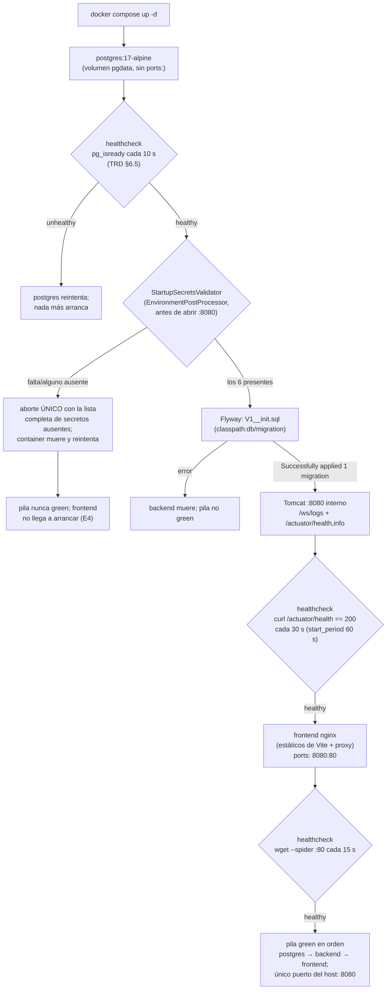
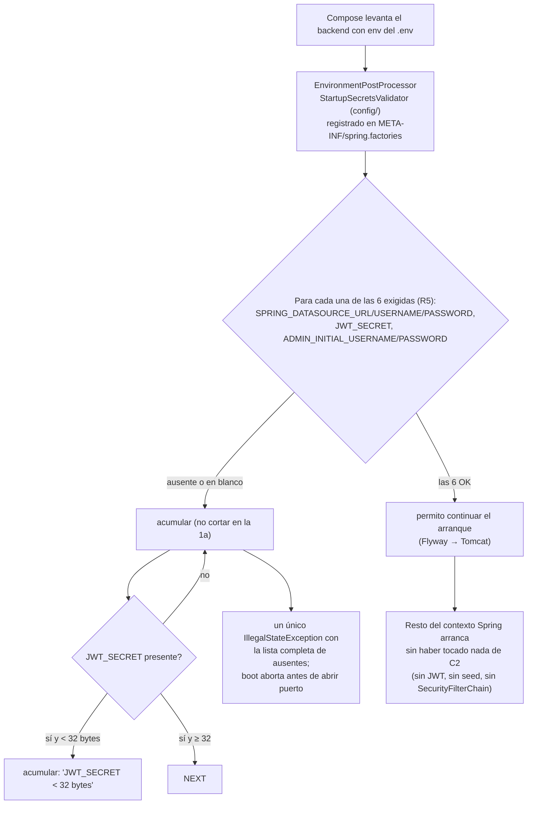

# Design — C1 · Fase 0: Setup de pila y repo

> Fase sdd-design del flujo SDD para C1. Diseña **cómo** se cumple el spec
> (R1–R15, E1–E12) con las decisiones cerradas de `proposal.md` (D1–D10,
> aprobadas en gate 2026-10-20). Los literales de los docs se **citan, nunca
> se redefinen**: este artefacto no reescribe `V1__init.sql`, el formato del
> `.env.example`, los healthchecks ni los bloques de nginx — solo sitúa cada
> pieza, elige el mecanismo de diseño que las satisface y explica por qué.

## 0. Resumen del diseño

C1 es un corte greenfield: el estado nuevo es **31 ficheros** creados de cero
en un repo git recién `init` (no hay código previo que toque). El diseño gira
sobre 8 decisiones (DD-1…DD-8) que fijan: el POM y el esqueleto de 8 paquetes,
el handler echo en `/ws/logs` con la mecánica de registro de C7, el fail-fast
de secretos como `EnvironmentPostProcessor`, los dos Dockerfiles multi-stage +
`nginx.conf` compuestos de los literales del TRD §6.1–6.2, la compose con
healthchecks encadenados, la ubicación y verificación en frío de las
migraciones Flyway y el protocolo del smoke `ws_echo_test.py`. Ninguna pieza
adielanta lógica de C2–C7 (§6).

---

## 1. Arquitectura del repo

### 1.1 Árbol completo de C1 (31 ficheros)

```
Project_Log/                          # raíz: `git init` aquí (R1)
├── compose.yaml                      # [1] orquestación de los 3 servicios (R10)
├── .env.example                      # [2] copia textual del formato TRD §6.3 (R11)
├── .gitignore                        # [3] raíz monorepo, reglas de R13
├── README.md                         # [4] operativo mínimo (R14)
├── backend/                          # proyecto Maven monomódulo (R1)
│   ├── pom.xml                       # [5] groupId com.projectlog (DD-1)
│   ├── src/main/java/com/projectlog/
│   │   ├── Application.java          # [6] @SpringBootApplication raíz
│   │   ├── auth/package-info.java        # [7]
│   │   ├── projects/package-info.java    # [8]
│   │   ├── keys/package-info.java        # [9]
│   │   ├── ingest/package-info.java      # [10]
│   │   ├── query/package-info.java       # [11]
│   │   ├── streaming/package-info.java   # [12]
│   │   ├── config/package-info.java      # [13]
│   │   ├── common/package-info.java      # [14]
│   │   ├── streaming/EchoSocketHandler.java   # [15] echo temporal (DD-2)
│   │   ├── config/WebSocketConfig.java        # [16] registro /ws/logs (DD-2)
│   │   └── config/StartupSecretsValidator.java # [17] fail-fast (DD-3)
│   └── src/main/resources/
│       ├── application.yml                # [18] actuator health,info; flyway on (R12)
│       ├── META-INF/spring.factories      # [19] registro del EnvironmentPostProcessor (DD-3)
│       └── db/migration/V1__init.sql      # [20] copia literal Schema §6.1 (R6)
├── docker/
│   └── Dockerfile                    # [21] backend multi-stage (DD-4, R8)
├── frontend/                         # proyecto Vite + React + TS (R7)
│   ├── package.json                  # [22] Vite 7 / React 19 / TS 5.x, tags exactos (DD-1)
│   ├── package-lock.json             # [23] comprometido → npm ci determinista
│   ├── vite.config.ts                # [24] build React mínimo, base './'
│   ├── tsconfig.json                 # [25]
│   ├── index.html                    # [26] entrada Vite → placeholder "pila OK" (D5)
│   ├── src/main.tsx                  # [27] bootstrap React vacío
│   ├── src/App.tsx                   # [28] contenido del placeholder (R7)
│   ├── src/vite-env.d.ts             # [29] tipos cliente Vite
│   ├── Dockerfile                    # [30] multi-stage node → nginx (DD-4, R8)
│   └── nginx.conf                    # [31] los 5 puntos del TRD §6.2 (R9)
└── scripts/
    └── ws_echo_test.py               # [32] smoke WS stdlib (DD-7, R4)
```

> Nota de conteo: [23] `package-lock.json` se genera con `npm install` en el
> paso 5 del plan (no se escribe a mano); se compromete en el mismo corte para
> que `npm ci` sea determinista. Sin él, el total es 30 ficheros.

### 1.2 Decisión de ubicación y por qué

| Fichero | Dónde vive | Por qué ahí |
|---|---|---|
| `compose.yaml` | Raíz | Orquesta los 3 servicios (backend, frontend, postgres) que viven en directorios diferentes; la compose a la raíz es lo que la propuesta cierra en D3. `backend/` y `frontend/` no conocen el deployment completo. |
| `.env` / `.env.example` | Raíz | El `.env` alimenta varias cosas a la vez: interpolación de la compose (`POSTGRES_*`, `FRONTEND_BIND`) y variables del backend (`SPRING_DATASOURCE_*`, `JWT_SECRET`, …). Un sitio solo evita dos fuentes de verdad. |
| `docker/Dockerfile` | `docker/`, NO `backend/` | Nombre literal fijado por el 06, ítem 3 (D3, R8). Se construye con `build.context: ./backend` + `dockerfile: ../docker/Dockerfile` (§1.3 del proposal): la configuración Maven no se duplica fuera de `backend/` y el Dockerfile compila relativo a su contexto. |
| `frontend/Dockerfile` + `frontend/nginx.conf` | `frontend/` | Literal del 06 (ítem 4/5): el Dockerfile construye al mismo nivel que el proyecto Vite (su `COPY . .` copia el scaffold) y el `nginx.conf` se copia a la imagen con `COPY nginx.conf /etc/nginx/conf.d/default.conf`. |
| `scripts/ws_echo_test.py` | `scripts/` | Es una herramienta de verificación del host, no parte del producto: no entra en ninguna imagen, se ejecuta desde el host contra `localhost:8080` (R4). Aislado evita mezclarse con el código de backend/frontend. |
| Migraciones | `backend/src/main/resources/db/migration` | Literal del Schema §6 (estrategia de migraciones): en el classpath del jar, ubicación por defecto de Flyway (`classpath:db/migration`) — cero configuración extra. |
| `META-INF/spring.factories` | `resources/META-INF/` | Mecanismo oficial de registro de `EnvironmentPostProcessor` en Boot 3.x (DD-3). |
| `README.md`, `.gitignore` | Raíz | Primer commit junto a `.env.example` (D7/R1): la convención del repo se fija antes de escribir código. |

**Regla transversal de ubicación**: ningún fichero de C1 pertenece a dos
módulos a la vez; la única dependencia de composición entre módulos es
`compose.yaml → dos Dockerfiles + .env`, siempre referenciada con rutas
relativas al contexto de build.

---

## 2. Decisiones de diseño (DD-1…DD-8)

### DD-1 · Estructura del POM y esqueleto de 8 paquetes (R2, R3, E12)

**POM** (`backend/pom.xml`), dos bloques:

1. **Parent**: `spring-boot-starter-parent` con la versión **exacta** de la
   línea 3.5.x fijada en el `<parent><version>…</version></parent>` en el
   momento de apply (política D1: nunca `3.5` flotante ni `LATEST`).
   Propiedades: `maven.compiler.release=21` (Java 21 LTS, D1) y
   `java.version=21`.
2. **Dependencias — exactamente las de R2, ninguna sobrante**:
   - `spring-boot-starter-web` (Tomcat embebido :8080, MVC — único servidor HTTP);
   - `spring-boot-starter-actuator` (contrato del healthcheck, R12);
   - `spring-boot-starter-websocket` (WebSocket nativo, sin STOMP/SockJS);
   - `org.flywaydb:flyway-core` + `org.flywaydb:flyway-database-postgresql`;
   - `org.postgresql:postgresql` (driver, scope runtime).

> Nota de diseño sobre Flyway: Boot 3.5 trae la línea Flyway 11.x, que ya
> separó el soporte por motor en módulos: `flyway-core` **solo** no sabe
> hablar con PostgreSQL. `flyway-database-postgresql` es el módulo oficial de
> motor que Flyway exige para PG (no es una dependencia "extra" de negocio: es
> la mitad obligatoria de la dependencia "flyway" que el R2 lista). Sin él,
> Flyway arranca pero aborta con "No database found to handle jdbc:postgresql://…"
> — se documenta aquí para que el paso 2 no lo descubra tarde.
> Deliberadamente **sin** `spring-boot-starter-test` (C1 no tiene tests que
> ejecutar; llegan con la primera lógica de C2 — ver §6).

**Esqueleto de paquetes** (D6, R3): 8 `package-info.java` bajo
`com.projectlog.<nombre>` con Javadoc de una a tres líneas que diga qué feature
o capa vivirá ahí (texto descriptivo, sin código). Nombres cerrados del TRD
§2.1: `auth`, `projects`, `keys`, `ingest`, `query`, `streaming` + `config` y
`common`. Tres de los 8 no son vacíos desde C1:

- `streaming/` → ya lleva `EchoSocketHandler` (DD-2) — el package-info anota
  explícitamente que el handler es **infraestructura de prueba del proxy, a
  sustituir por `LogSocketHandler` en C7**;
- `config/` → ya lleva `WebSocketConfig` (DD-2) y `StartupSecretsValidator` (DD-3);
- `config` de Flyway/actuator → vía `application.yml` ([18]), no código: lo que
  C1 configura de Flyway/actuator son propiedades, no beans.

`Application.java` ([6]) queda en la raíz del package `com.projectlog` con solo
`@SpringBootApplication` — es el nivel al que escanean los 8 paquetes.

**Por qué esta decisión**: fija la convención package-by-feature antes de la
primera línea de C2 (renombra después cuesta, explore D6/D6), hace el árbol
verificable contra TRD §2.1 desde E12, y el Javadoc de cada `package-info` es
la primera documentación de la convención.

### DD-2 · `EchoSocketHandler` y registro nativo en `/ws/logs` (R4, R15; E5, E6)

**`streaming/EchoSocketHandler`** ([15]):

```java
// comportamiento completo de la clase (C1):
public class EchoSocketHandler extends TextWebSocketHandler {
    @Override
    protected void handleTextMessage(WebSocketSession session, TextMessage message)
            throws IOException {
        session.sendMessage(new TextMessage(message.getPayload()));
    }
}
```

- `TextWebSocketHandler` nativo de Spring (ADR-5/§2.8: nada de STOMP ni SockJS);
  respone **cada frame de texto recibido con el mismo payload**, frame a frame —
  no hay sesión de broadcast, filtros ni estado.
- Un solo cliente (el smoke) y respuesta inmediata → la escritura directa por
  `session.sendMessage` es suficiente; no se añade `ConcurrentWebSocketSessionDecorator`
  (sería mecanismo de C7, §6).
- Los frames binarios no se gestionan (no se sobreescribe `handleBinaryMessage`):
  el protocolo del smoke (DD-7) solo usa frames de texto.
- Sin `HandshakeInterceptor`, sin seguridad, sin auth: C1 no tiene JWT (C2) —
  así el proxy se prueba "en limpio", sin mezclar auth con infraestructura (D2).

**`config/WebSocketConfig`** ([16]) — la pieza diseñada para reutilizar en C7:

```java
@Configuration
@EnableWebSocket
public class WebSocketConfig implements WebSocketConfigurer {
    @Override
    public void registerWebSocketHandlers(WebSocketHandlerRegistry registry) {
        registry.addHandler(echoSocketHandler(), "/ws/logs");
        // C1: sin .withSockJS() — ADR-5; sin .addInterceptors(...) — C7
    }
}
```

- Ruta **definitiva** `/ws/logs` (coincide carácter a carácter con la ruta del
  `location` del nginx y con el contrato del TRD §9: el proxy solo enruta
  `/api/v1/**` + `/ws/logs`; prohibido `/ws/echo`, R4/R15).
- El registro (`implements WebSocketConfigurer` → `addHandler(handler, "/ws/logs")`)
  es **exactamente la mecánica que C7 reutiliza**: en C7 solo cambia el bean
  conectado (`EchoSocketHandler` → `LogSocketHandler real` + `HandshakeInterceptor`
  con JWT 401 pre-upgrade); ni el nginx ni el smoke se reescriben (07 C7: "el
  echo test del proxy WS de C1 siga verde con el handler real").
- El `handler` es el **único punto de sustitución** de C1→C7: el `package-info`
  de `streaming` lo deja anotado para que el corte C7 lo localice de un vistazo.

**Ruta vs. `proxy_pass`**: el `location /ws/logs` del nginx usa
`proxy_pass http://backend:8080;` **sin URI final** (DD-4): así el request URI
`/ws/logs` (y subpaths futuros como `/ws/logs?token=…`) llega **sin alterar**
al handler registrado exactamente con la cadena `/ws/logs`. Con una barra
final (`http://backend:8080/`) nginx trocearía el uri y rompería el emparejamiento
con el addHandler — es el error clásico de este bloque y se evita por diseño
literal del TRD §6.2.3.

### DD-3 · Fail-fast de secretos: `EnvironmentPostProcessor` (R5, R15; E4)

**Mecanismo elegido: un `EnvironmentPostProcessor`** (`config/StartupSecretsValidator`,
[17] + registro en `META-INF/spring.factories` [19] con clave
`org.springframework.boot.env.EnvironmentPostProcessor`).

Racional del mecanismo (y por qué las otras opciones se descartan):

| Opción | Cuándo corre | Veredicto |
|---|---|---|
| **`EnvironmentPostProcessor`** | Antes del `ApplicationContext` refresh: **antes de crear ningún bean**, antes de tocar DataSource/JDBC, antes de que Tomcat exista | **Elegida**.Aborta la JVM en el punto más temprano posible: no puede haber "verde fugaz" ni conexión a BD fallida — el contenedor muere en segundos. Distingue "falta un secreto" (config) de "Falló la inyección de un bean" (código). |
| `@PostConstruct` sobre un `@Configuration` | Durante el contexto, tras crear DataSource/Flyway y, ojo, **después** de que Tomcat pueda empezar a escuchar en orden de beans | Descartada (D4): corrige demasiado tarde; corre riesgo de verde fugaz con el healthcheck (E4 lo prohíbe literalmente: "ningún verde fugaz"). |
| `ApplicationRunner` | Tras arrancar todo, ya con Tomcat escuchando | Descartada (D4): aún más tarde; un verde fugaz es casi seguro. |
| Validaciones sueltas `@Value(... no disponible)` / `@Validated` | Durante el binding de un bean | Descartada (D4): falla **una por una** (mala UX de diagnóstico, contradice "un único error que liste TODOS los ausentes"). |
| Chequeo en shell/compose (`test -n "$JWT_SECRET"` en el entrypoint) | Antes de lanzar la `java` | Descartada como principal: duplicaría la lista fuera de Java y el contracto del R5 pide el validador **en `config/`**. (Mantenida como red de seguridad implícita: si falta `POSTGRES_PASSWORD`, postgres nunca llega healthy y el backend ni arranca — D4). |

**Contrato exacto del validador** (lo que C1 pide, ni un requisito más):

- Lee del `Environment` (las env vars del contenedor, ya resueltas por Compose
  desde el `.env`) las **6 variables exigidas** de R5:
  `SPRING_DATASOURCE_URL`, `SPRING_DATASOURCE_USERNAME`,
  `SPRING_DATASOURCE_PASSWORD`, `JWT_SECRET`, `ADMIN_INITIAL_USERNAME`,
  `ADMIN_INITIAL_PASSWORD`;
- Fallan por: ausentes **o en blanco** (`null`/vacío/espacios);
- Chequeo extra literal de R5: `JWT_SECRET` **debe medir ≥ 32 bytes** (se
  cuentan bytes UTF-8, no caracteres — el literal del TRD §5 es "≥32 bytes
  aleatorios");
- Si hay fallos, **acumula todos** y aborta con **un único `IllegalStateException`
  cuyo mensaje lista todas las ausentes de golpe** (nombre corto de cada var +
  qué se esperaba). El mensaje no contiene secretos (solo nombres);
- Nunca lanza una lista parcial: se recorren las 6 sin cortar en la primera.
- No lee, valida ni antecipa nada de C2: **no** firma JWT, **no** crea el seed
  del admin, **no** define SecurityFilterChain. Chequea **presencia de
  configuración**, que es el contrato que R5 fija para C1 (el chequeo es
  config, no adelanta código de C2).
- No exige ninguna de las 8 con default (R5): `JWT_TTL_HOURS` (8),
  `INGEST_MAX_REQUEST_BYTES`, `INGEST_MAX_BATCH_SIZE`, `WS_HEARTBEAT_SECONDS`,
  `LOGGING_LEVEL`, `SPRING_PROFILES_ACTIVE`, `TZ`, `FRONTEND_ORIGIN`,
  `FRONTEND_BIND` — ni se tocan.

**Por qué no adelanta C2** (exigencia del enunciado): la clase consume el
`Environment` y compara con una **lista estática declarada en un array de
constantes** con el nombre y el motivo de cada var. En C2, cuando llegue el
código real (Argon2id, JWT, semilla), el validador no se reescribe: se queda
como está (quizá gane el chequeo de formato de `SPRING_DATASOURCE_URL`, decisión
de C2) y el resto de código de C2 consume los secretos por su cuenta. El
diseño mantiene la frontera: **config ≠ feature**.

**Efecto en la pila (E4)**: al faltar/estar en blanco un secreto, el proceso
java muere antes de abrir :8080 → el healthcheck del backend nunca da 200 →
`frontend` (que depende `service_healthy` del backend) no llega a arrancar →
la pila no llega a green y `docker compose logs backend` muestra el único error
agregado. Con `restart: unless-stopped` el contenedor reintenta, vuelve a
abortar: es un bucle controlado y esperado hasta restaurar el `.env` (ver
riesgo RG-6 en §5).

### DD-4 · `docker/Dockerfile`, `frontend/Dockerfile` y `nginx.conf` (R8, R9; DD-5 los conecta)

**`docker/Dockerfile`** (backend; [21]) — se construye con
`build.context: ./backend` + `dockerfile: ../docker/Dockerfile` (R8/D3):

```dockerfile
# Stage 1 — build (tags exactos, D1; maven:3.9-eclipse-temurin-21 del R2)
FROM maven:3.9-eclipse-temurin-21 AS build
WORKDIR /app
COPY pom.xml .
RUN mvn -q -DskipTests dependency:go-offline    # cache de deps como capa propia
COPY src ./src
RUN mvn -q -DskipTests package

# Stage 2 — runtime (temurin-21-jre del R8, tag exacto, sin build tools)
FROM eclipse-temurin:21-jre
RUN apt-get update && apt-get install -y --no-install-recommends curl \
    && rm -rf /var/lib/apt/lists/*     # solo para el healthcheck del TRD §6.5
COPY --from=build /app/target/*.jar /app/app.jar
EXPOSE 8080
ENTRYPOINT ["java", "-jar", "/app/app.jar"]
```

- Multi-stage literales del 06 ítem 3: build Maven → runtime **JRE** (no JDK).
- `dependency:go-offline` separa la capa de dependencias para que tocar código
  no re-descargue el mundo (builds iterativos de C2–C7 rapidísimos).
- `curl` en el runtime: el contrato del healthcheck (TRD §6.5:
  `GET /actuator/health` → 200) necesita un cliente HTTP en el contenedor; la
  imagen `eclipse-temurin:21-jre` (Ubuntu) no lo trae de serie. Es el único
  binario añadido y su razón se comenta en el Dockerfile. Alternativa descartada:
  mover el healthcheck al lado del host (imposible: backend sin `ports:`).
- Sin `HEALTHCHECK` dentro del Dockerfile: los tres healthchecks viven en
  `compose.yaml` (DD-5) para que el encadenamiento y el check se lean juntos.
- `EXPOSE 8080` documental (no publica nada; sin `ports:` en la compose, R10).

**`frontend/Dockerfile`** ([30]) — multi-stage node → nginx (06 ítem 4):

```dockerfile
# Stage 1 — build (node:22-alpine del R2, solo builder)
FROM node:22-alpine AS build
WORKDIR /app
COPY package.json package-lock.json ./
RUN npm ci                               # determinista gracias a package-lock comprometido
COPY . .
RUN npm run build                        # → /app/dist

# Stage 2 — nginx estáticos (nginx:stable-alpine, D8)
FROM nginx:stable-alpine
COPY nginx.conf /etc/nginx/conf.d/default.conf
COPY --from=build /app/dist /usr/share/nginx/html
EXPOSE 80
```

- `npm ci` (no `npm install`) reproduce exactamente `package-lock.json` [23]
  comprometido — política de reproducibilidad del gate p. 1 aplicada al build
  de Vite, no solo a las imágenes.
- La imagen final **solo** tiene nginx + estáticos: el builder Node no aparece
  en la imagen (superficie mínima, coherente con §6.7).
- `nginx:stable-alpine` trae `busybox wget` de serie — es el binario del
  healthcheck trivial de D8/R10 (verificado en apply; riesgo RG-4).

**`frontend/nginx.conf`** ([31]) — composición de los 5 puntos del TRD §6.2
(R9), que se citan y no se redefinen; el detalle de diseño es solo en los
puntos que el literal deja al implementador:

1. `server { listen 80; root /usr/share/nginx/html; index index.html; ... }`
2. **SPA fallback**: `location / { try_files $uri /index.html; }` — literal §6.2.1 (E9).
3. **Proxy API**: `location /api/v1/ { proxy_pass http://backend:8080; ... }`
   — literal §6.2.2 con rutas relativas (cero CORS; E8). Sin URI final tras
   `host:puerto` por el mismo motivo del WS (DD-2): el prefijo `/api/v1/`
   **debe llegar al backend intacto** (los controllers de C2–C6 mapean sobre
   ese prefijo; trocearlo rompería el contrato).
4. **Bloque WS** — literal §6.2.3/ADR-18 tal cual: `location /ws/logs` con
   `proxy_http_version 1.1`, `proxy_set_header Upgrade $http_upgrade`,
   `proxy_set_header Connection "upgrade"`, `proxy_read_timeout 3600s` y
   `proxy_send_timeout 3600s`. El diseño añade el matiz operativo: la
   `Connection "upgrade"` **fija (sin `map $http_upgrade`)** es el literal del
   spec y del TRD, y en C1 la ruta solo la usa el WS, así que el `map`
   (necesario cuando la misma location puede servir HTTP plano) no aporta.
5. **Cabeceras `Host` / `X-Real-IP`** en ambos proxys (`proxy_set_header Host
   $host; proxy_set_header X-Real-IP $remote_addr;` + `X-Forwarded-For`) —
   literal §6.2.4; más `proxy_set_header X-Forwarded-Proto $scheme` como
   práctica mínima que el literal no prohíbe; **sin TLS** en todo el conf
   (§6.2.5 / ADR-23).

### DD-5 · `compose.yaml`: orden, healthchecks, red, volumen, puerto (R10; E1, E2, E10)

Estructura (los literales de healthchecks/encadenamiento/topología se **citan**,
no se redefinen: TRD §6.1, §6.4, §6.5; 06 ítem 6):

- **Servicios** (en el orden de arranque del encadenamiento):
  1. `postgres` — imagen `postgres:17-alpine` (tag cerrado en GATE #8 y en
     E9/A16 de la propuesta — no se reemplaza). `environment` con
     `POSTGRES_DB`/`POSTGRES_USER`/`POSTGRES_PASSWORD` interpolados del `.env`
     (sin secretos en el fichero R10). Healthcheck **literal TRD §6.5**:
     `pg_isready -U $POSTGRES_USER -d $POSTGRES_DB` cada 10 s
     (`interval: 10s`, `timeout: 5s`, `retries: 5`).
  2. `backend` — `build: { context: ./backend, dockerfile: ../docker/Dockerfile }`
     (R8). `depends_on: postgres: { condition: service_healthy }` — **el
     backend no aplica Flyway hasta que postgres es healthy** (Schema §6, el
     orden postgres → backend es el literal del TRD §6.5). `environment` con
     las vars del backend del TRD §6.3. Healthcheck **literal TRD §6.5**:
     `GET /actuator/health` → 200 (`curl -fsS http://127.0.0.1:8080/actuator/health`)
     cada 30 s (`interval: 30s`, `timeout: 5s`, `retries: 5`,
     `start_period: 60s` — margen para JVM + Flyway V1 sin dar el punto de
     muerto antes de vez).
  3. `frontend` — `build: { context: ./frontend }`. `depends_on: backend:
     { condition: service_healthy }` (TRD §6.5: "el frontend arranca solo con
     backend healthy"). Único `ports:` de toda la pila: `8080:80` host (ADR-24).
     Healthcheck **literal TRD §6.5/D8**: `wget --spider -q http://127.0.0.1/`
     sobre su propio :80 (`interval: 15s`, `timeout: 3s`, `retries: 3`).
- **`FRONTEND_BIND`**: se respeta el literal del TRD §6.3 ("IP de escucha del
  puerto publicado, defecto `0.0.0.0`, opcional") con la interpolación
  `"${FRONTEND_BIND:-0.0.0.0}:8080:80"`: en `.env.example` la var sigue
  **comentada** (R11); sin ella, la compose resuelve exactamente a `8080:80`
  del R10. No se inventa ninguna var nueva.
- **Red**: una sola, `project_log_net` (bridge), declarada y conectada a los 3
  — literal §6.1; es la red en la que los nombres de servicio
  (`postgres`, `backend`) resuelven por DNS → son exactamente los nombres que
  exigen `SPRING_DATASOURCE_URL=jdbc:postgresql://postgres:5432/…` (TRD §6.3)
  y `proxy_pass http://backend:8080` (TRD §6.2).
- **Volumen**: `pgdata` nombrado, montado en `/var/lib/postgresql/data`
  (§6.4); vive en local como `project_log_pgdata` (E3).
- **`restart: unless-stopped` en los 3** (§6.1). **Sin `ports:`** en
  backend/postgres, **sin `mem_limit`** (ADR-27), **sin `version:`** (D10 —
  Compose Spec v2), **sin secretos** en el fichero.

**Por qué los healthchecks viven en compose y no en los Dockerfiles**: el
encadenamiento `depends_on: service_healthy` y las cadencias son contrato de
**topología** (§6.5), no de imagen; leerlos junto al `depends_on` hace la
verificación del E1 directa en un único fichero, y cambiar cadencias en C9 no
obliga a reconstruir imágenes. El `curl` del backend vive en el Dockerfile
porque es un binario de imagen (DD-4).

### DD-6 · Flyway: ubicación y verificación en frío (R6; E3)

**Ubicación**: `backend/src/main/resources/db/migration/V1__init.sql` ([20]) —
ruta por defecto de Flyway (`classpath:db/migration`). En `application.yml`
([18]): `spring.flyway.enabled: true` (implícito en presencia del módulo +
datasource; se fija explícito para legibilidad) y **sin** `baseline-on-migrate`
(el esquema nace vacío: V1 es la primera migración y no hay baseline que dar).
Hibernate no gestiona DDL: `spring.jpa.hibernate.ddl-auto: none` explícito para
que nada más toque el esquema (el esquema es del Schema §6.1, literal).

**El fichero como contrato**: V1__init.sql es **copia literal** del Schema
§6.1 (3 tablas + constraints + 4 índices; trigram **solo comentada** en la
cola, reservada a V2). El paso 4 del plan (proposal) exige diff contra el doc
= cero caracteres; **el fichero no se edita nunca tras aplicarse** (checksum
de Flyway; la evolución es V2+ — R6, R15).

**Verificación en frío** (D9; comprobación de apply, no código): el
procedimiento literal de la propuesta:

1. Pila en frío real: `docker compose down` (sin `-v`) + `docker volume rm
   project_log_pgdata` — **solo en local, donde en C1 no hay nada que perder**
   (en la VM nunca: `-v` prohibido salvo desastre deliberado, TRD §6.4);
   `docker compose up -d` de nuevo.
2. Postgres healthy → backend arranca → los logs del backend muestran
   `Successfully applied 1 migration` (línea de evidencia para E3).
3. Verificación con un psql efímero sobre la red de la pila:
   `docker run --rm --network project_log_net postgres:17-alpine psql -h
   postgres -U <user> -d <db> -c '\dt' …` — comprueba: `\dt` lista `users`,
   `projects`, `logs`; `flyway_schema_history` tiene la fila de V1 con
   `success` (columna `success` = true); los **4 índices** del §6.1 existen
   (`logs_dashboard_idx`, `logs_received_idx`, `logs_correlation_idx`,
   `projects_api_key_hash_idx` único parcial) y **NO existe**
   `logs_message_trgm_idx` (la trigram no se ejecutó).

Nota de diseño: la primera conexión JDBC del backend solo la abre Flyway, así
que la comprobación "en frío" cubre la cadena completa del arranque
(postgres healthy → driver → migración → Tomcat escuchando).

### DD-7 · `scripts/ws_echo_test.py`: protocolo del eco test (R4; E5–E7)

Script **Python stdlib solo** (`socket`, `base64`, `hashlib`, `os`, `struct`,
`argparse`, `sys`, `time`) — sin `websocket-client`, sin `websocat`, sin Node
(decisión D2: nada que instalar para el smoke; D8/D2 alternativas ya
descartadas). Implementa a pelo el mínimo RFC 6455 necesario para un cliente:

**CLI** (dos modos desde C1, reutilizables en C7 sin reescritura — R4):

```
python3 scripts/ws_echo_test.py [--host HOST] [--puerto PUERTO]
       [--solo-handshake] [--sin-inactividad] [--idle-segundos 75]
       [--payload TEXT] [--token TOKEN]   # --token: se usa solo en C7
```

**Paso 1 · Handshake (común a los dos modos)** — construye y envía a pelo:

```
GET /ws/logs HTTP/1.1
Host: <host>:<puerto>
Upgrade: websocket
Connection: Upgrade
Sec-WebSocket-Key: <base64 de 16 bytes aleatorios>
Sec-WebSocket-Version: 13
```

y verifica: línea de status `101 Switching Protocols`; y que
`Sec-WebSocket-Accept` sea **exactamente**
`base64(sha1(Sec-WebSocket-Key + "258EAFA5-E914-47DA-95CA-C5AB0DC85B11"))`
(el GUID fijo del RFC 6455) — si el Accept no es el correcto no se continúa
(con `curl -i http://localhost:8080/ws/logs` + cabeceras de upgrade, la
misma verificación es reproducible a mano: E5). El bloque que esta petición
ejercita es el `location /ws/logs` del nginx (TRD §6.2.3) + la negociación del
backend — **el camino de producción entero**, sin atajos por dev (R4).

**Paso 2 · Eco full-duplex** (solo en modo completo): envía N frames de texto
mascarados (los frames del cliente van **mascarados**, obligación del RFC;
el servidor responde sin máscara), opcode `0x1` FIN=1, un frame por mensaje;
para cada frame parsea la respuesta (opcode, longitud, payload) y exige
**eco idéntico byte a byte** y opcode texto; al final del ciclo envía close
frame `0x8` y espera el close de vuelta (cierre limpio). Ejercita
cliente → nginx → backend → nginx → cliente ida y vuelta (E6).

**Paso 3 · Inactividad > 75 s** (solo en modo completo): con la conexión aún
abierta del paso 2, **no envía nada durante `--idle-segundos` (default 75)** y
luego envía un frame de comprobación y exige su eco → la conexión ha
sobrevivido al intervalo. El default de nginx sin configurar es
`proxy_read_timeout 60s`: una conexión muerta a 60 s falla este paso, y un
bloque con 3600 s pasa — es el observador dinámico del timeout (E7) que
complementa la revisión estática del diff (3600 s + `proxy_http_version 1.1` +
cabeceras Upgrade/Connection en el literal §6.2.3, revisada como parte del
paso 6 del plan). Un test de los 3600 s completos sería impracticable y no
aporta (proposal §3).

**Modos y reutilización en C7** (diseñados desde C1, R4):

- modo por defecto: pasos 1+2+3 (smoke completo, es el del README de C1);
- `--solo-handshake`: para en el paso 1 tras validar el 101 + Accept — en C1
  es la comprobación rápida de la infraestructura; en **C7 se re-ejecuta igual
  con `--token <JWT>`** (el `--token` ya existe como CLI y añade el query param
  al path del handshake `/ws/logs?token=…`; en C1 **nunca** se pasa). C7 no
  reescribe el script: solo cambia el handler al otro lado, que el verdaderos
  objeto de la prueba (el proxy) es el mismo.
- `--sin-inactividad`: salta el paso 3 para iteraciones rápidas (el smoke
  canónico del gate de archive incluye el paso 3 siempre).

**Permisos y ubicación**: `chmod +x scripts/ws_echo_test.py`, shebang
`#!/usr/bin/env python3`; vive en `scripts/` y **no entra en ninguna imagen**
(D1); se ejecuta solo desde el host contra `localhost:8080` — la pila siempre
levantada con `docker compose up` (R4: nunca en dev). Sin secretos, sin estado:
idempotente ante reejecución.

### DD-8 · `application.yml` de C1 (R12; E10)

Mínimo y con los puntos que la pila necesita para el contrato:

```yaml
server.port: 8080
spring:
  datasource:
    url:      ${SPRING_DATASOURCE_URL}       # jdbc:postgresql://postgres:5432/project_log
    username: ${SPRING_DATASOURCE_USERNAME}
    password: ${SPRING_DATASOURCE_PASSWORD}
  flyway:
    enabled: true                            # V1 desde classpath:db/migration (DD-6)
  jpa:
    hibernate.ddl-auto: none                 # el esquema es de V1__init.sql, nada más lo toca
management:
  endpoints.web.exposure.include: health,info   # literal TRD §6.5/§9 (R12)
logging.level.root: ${LOGGING_LEVEL:INFO}
```

- `exposure.include: health,info` es el literal del contrato healthcheck
  (TRD §6.5/§9): cualquier endpoint de actuator responde 404 y `/actuator/**`
  no es enrutable desde el host (el nginx solo enruta `/api/v1/**` + `/ws/logs`)
  — E10.
- Lo que no aparece deliberadamente: nada de seguridad, nada de `FRONTEND_ORIGIN`
  (C1 no consume CORS), nada de `WS_HEARTBEAT_SECONDS` (heartbeat es C7),
  nada de límites de ingesta (C5) — ver §6.

---

## 3. Diagramas de flujo

### 3.1 Arranque de la pila: compose → healthchecks → panel



En paralelo al `depends_on: service_healthy` (postgres → backend → frontend,
literal del TRD §6.5), el fail-fast de DD-3 corta **antes** de que cualquier
healthcheck pueda dar verde: no puede existir un backend "green" sin secretos.

### 3.2 Ciclo del echo test (`scripts/ws_echo_test.py`, siempre contra la pila completa)

```mermaid
sequenceDiagram
    participant S as ws_echo_test.py (host)
    participant N as nginx :80 → host 8080
    participant B as backend /ws/logs (EchoSocketHandler)

    Note over S,N: Paso 1 · Handshake (común; modo --solo-handshake termina aquí)
    S->>N: GET /ws/logs HTTP/1.1 · Upgrade: websocket · Connection: Upgrade<br/>Sec-WebSocket-Key (aleatoria) · Sec-WebSocket-Version: 13
    N->>B: proxy_http_version 1.1 + Upgrade/Connection (TRD §6.2.3)
    B-->>N: 101 Switching Protocols + Sec-WebSocket-Accept
    N-->>S: 101 (Validar Accept = sha1(Key+GUID); si falla → abortar)
    S->>S: [en C7: mismo paso con --token <JWT> --solo-handshake]

    Note over S,B: Paso 2 · Eco full-duplex
    loop N frames (default)
        S->>N: frame TEXTO (FIN=1, opc. 0x1, MASCARADO — RFC 6455)
        N->>B: frame reenviado
        B-->>S: frame TEXTO con el payload IDÉNTICO (eco)
    end
    S->>B: close frame 0x8
    B-->>S: close de vuelta (cierre limpio)

    Note over S,B: Paso 3 · Inactividad > 75 s (solo modo completo)
    S->>S: conectar de nuevo (paso 1) · NO enviar frames durante --idle-segundos (default 75)
    S->>B: frame de comprobación
    B-->>S: eco → conexión viva a los >75 s (timeout nginx >60 default, coherente con 3600s)
```

### 3.3 Flujo del fail-fast (y cómo no adelanta C2)



---

## 4. Mapa escenarios (spec §2) → mecanismo de diseño

| Escenario | Requisitos que cubre | Piezas del diseño que lo hacen posible/verificable |
|---|---|---|
| **E1** Pila green en orden | R10 | DD-5: healthchecks literales del TRD §6.5 declarados en compose + `depends_on: service_healthy` encadenado postgres → backend → frontend; `restart: unless-stopped` en los 3; red única y volumen nombrado; diagrama §3.1. |
| **E2** Único 8080 con placeholder | R7, R8, R9, R10 | DD-4: frontend Dockerfile multi-stage (Node build → `nginx:stable-alpine` + estáticos) y DD-5: único `ports: 8080:80` del host; backend/postgres sin `ports:`; DD-1 + R7: placeholder es la salida del build Vite real (App.tsx, R7). |
| **E3** Flyway V1 en frío | R6 | DD-6: V1__init.sql literal del Schema §6.1 en `classpath:db/migration`, sin `baseline-on-migrate`, `ddl-auto: none`; verificación con `psql` efímero sobre `project_log_net` (down + rm de volumen solo en local). |
| **E4** Fail-fast verificado | R5 | DD-3: `EnvironmentPostProcessor` con agregación de los 6 secretos + chequeo ≥32 bytes de `JWT_SECRET`; aborta antes de abrir :8080 → sin verde fugaz; efecto pila = backend muerto + frontend nunca arranca (§3.1). |
| **E5** Handshake WS 101 vía nginx | R4, R9 | DD-2 (registro nativo `addHandler(…, "/ws/logs")` exacto) + DD-4 (bloque `location /ws/logs` con Upgrade/Connection/http 1.1 + `proxy_pass` sin URI final) + DD-7 paso 1 (101 + Accept correcto, replicable con `curl -i`). |
| **E6** Echo full-duplex | R4 | DD-2 (`handleTextMessage` → eco payload idéntico, sin estado) + DD-7 paso 2 (frames mascarados, parse opcodes/longitud, close limpio 0x8). |
| **E7** Inactividad > 75 s | R9 | DD-7 paso 3 (`--idle-segundos 75`) + revisión estática en apply de los literales 3600 s / `proxy_http_version 1.1` / cabeceras Upgrade/Connection del `nginx.conf` (DD-4). El default 60 s de nginx discrimina: muerto a 60, vivo a 75+ solo con timeouts del literal. |
| **E8** Proxy `/api/v1` sin endpoints | R9, R15 | DD-4: `location /api/v1/ { proxy_pass http://backend:8080; … }` sin URI final (prefijo intacto) + DD-1: el backend no declaró controllers → Spring responde su 404 JSON (no HTML de nginx): el proxy alcanza al backend. |
| **E9** SPA fallback | R9 | DD-4 punto 1: `location / { try_files $uri /index.html; }` (literal §6.2.1) — el placeholder sirve para cualquier ruta de panel. |
| **E10** Actuator solo `health,info` | R12 | DD-8: `management.endpoints.web.exposure.include: health,info` literal; DD-5: el healthcheck del compose usa solo `/actuator/health`; el nginx no enruta `/actuator/**` (solo `/api/v1/**` + `/ws/logs`, TRD §9). |
| **E11** `.env` fuera de git | R1, R13 | DD-1: primer commit con `.gitignore` raíz (`.env` + `.env.*` excepto `.env.example`) + `.env.example` (copia literal §6.3, sin secretos) + README (chmod 600). Verificación: `git status` limpio con `.env` creado. |
| **E12** Estructura/build verificables | R2, R3 | DD-1: POM exacto (parent 3.5.x fijado, dependencias mínimas, release 21) + árbol de 8 `package-info.java` con nombres TRD §2.1; `npm ci` determinista con lock comprometido; tags exactos en POM y en los 2 Dockerfiles para `docker compose build`. |

Cobertura completa: R1–R15 quedan atendidos (R1/R13 por DD-1 y la ubicación de
§1; R2/R3/R15 por DD-1; R4 por DD-2 + DD-7; R5 por DD-3; R6 por DD-6; R7/R8/R9
por DD-4; R10 por DD-5; R11 por DD-1/.env.example; R12 por DD-8; R14 por
README operativo de §1).

---

## 5. Riesgos de diseño y mitigación

| # | Riesgo | Impacto | Mitigación en el diseño |
|---|---|---|---|
| **RG-1** | **Tags de imágenes: tensión entre "tags exactos" (R2/propuesta) y literales ya citados (`postgres:17-alpine`, `maven:3.9-eclipse-temurin-21`, `node:22-alpine`, `nginx:stable-alpine`) que son "menor fijo", no parche exacto** | Un build en otro momento puede resolver un parche distinto | Política única, declarada aquí: **sin `latest`, sin flotantes entre mayores, actualización manual `--pull`** (D1, TRD §6.4). El criterio operativo es el mismo que ya cerró el GATE para postgres (tag de línea menor fija). Para el backend `pom.xml` sí se fija el patch exacto de SB 3.5.x. Si verify/apply quiere reproducibilidad byte-exacta, se anclan los tags con patch (`node:22.<x>.<y>-alpine3.<z>`) como decisión menor de tasks — el diseño no depende de eso. |
| **RG-2** | **Compatibilidad SB 3.5.x / Java 21**: baseline y APIs de WS nativas | El arranque o el registro WS podrían requerir APIs que cambien | SB 3.5.x soporta Java 21 (es LTS dentro de su ventana); `WebSocketConfigurer`/`addHandler`/`TextWebSocketHandler` son APIs estables de la línea 3.x intactas en 3.5 (D1). Cualquier sorpresa se resuelve fijando patch, no cambiando línea. |
| **RG-3** | **Flyway 11.x (que viene con Boot 3.5) ya no incluye el driver de motor en `flyway-core`** | `mvn package` verde pero arranque abortado con "no database found to handle jdbc:postgresql://" | Resuelto por diseño: DD-1 incluye `flyway-database-postgresql` explícitamente y explica el porqué (la mitad obligatoria de la dependencia "flyway" del R2). Riesgo #4 del 06 se ataca además con la verificación en frío de E3 en el propio corte. |
| **RG-4** | **`nginx:stable-alpine` sin `wget`** (D8 asumía busybox wget) o sin `curl` en el runtime del backend | Healthcheck del frontend/backend falsea o muere | DD-5 fija wget como check del frontend (busybox wget de serie en alpine — se verifica de un `docker run --rm nginx:stable-alpine which wget` en apply); DD-4 añade `curl` explícito al runtime del backend, la pieza que el TRD exige (`GET /actuator/health` → 200) y que la imagen Temurin no trae. Si el check de alpine fallara, el fallback documentado es reemplazar `wget` por `curl` instalado en el stage nginx — decisión puntual, nunca se cambia en medio del corte (D8). |
| **RG-5** | **WS nativo sin ping vs. nginx timeouts**: con el handler echo no hay heartbeat, y el `proxy_read_timeout` de nginx es tiempo **entre datos** — una conexión inactiva sin configurar moriría al default 60 s | E7 flashea un falso verde si el bloque del nginx está incompleto | Es justamente lo que el diseño usa al revés: el paso 3 de DD-7 exige vida a >75 s — con default 60 muere, con 3600 vive; complementado por revisión estática del diff (`proxy_read_timeout`/`proxy_send_timeout 3600s` + `proxy_http_version 1.1` + Upgrade/Connection literal). El heartbeat real (30 s, `WS_HEARTBEAT_SECONDS`) es C7 y NO se anticipa: el echo de C1 no depende de él (explora D2/explore D4). |
| **RG-6** | **Fail-fast con `restart: unless-stopped` = bucle de reinicio del backend** durante la verificación de E4 (y siempre que falte un secreto) | Parece una pila "colgada"; el error puede perderse | Comportamiento esperado y documentado (DD-3/§3.1): el contenedor muere **antes** de que cualquier healthcheck dé green, y el diagnóstico es `docker compose logs backend` → el único error agregado con la lista completa. El README (R14) documenta esa lectura del log como primer paso de diagnóstico. |
| **RG-7** | **Permisos/ejecución de `scripts/ws_echo_test.py`** (no ejecutable, o con dependencias de sistema no disponible) | El smoke no se puede repetir (rompe la trazabilidad C7) | `chmod +x` + shebang `#!/usr/bin/env python3` de la distro del host; **cero dependencias externas** por diseño (stdlib sola, sin pip/npm/websocat — DD-7). El script vive en `scripts/` y no entra en imágenes (D1). Su re-ejecución en C7 no exige tocar código del host. |
| **RG-8** | **404 de Spring en E8 puede salir como HTML** si el cliente no negocia JSON (y así el escenario no distingue proxy de SPA) | Ambigüedad en la demostración de que el proxy llega al backend | La petición canónica de aplicación (README) usa `curl -H "Accept: application/json" http://localhost:8080/api/v1/nonexistent` → el `/error` de Boot responde JSON (`{"timestamp","status","error","path"}`); el contraste con E9 (mismo patrón de ruta bajo `/` → HTML del placeholder) queda inequívoco. Se documenta en README en vez de confiar en el Accept por defecto. |

---

## 6. No-decisiones (explícitamente para C2–C7; el design no las anticipa)

Lo que este diseño **no** define ni resuelve hoy, y dónde vive la decisión:

- **C2** — `SecurityFilterChain` con las dos cadenas (panel JWT / ingesta API
  key), Argon2id (ADR-3, librería PHC/plan B del 06), JWT HS256 + filtro (TTL
  8 h ADR-13), seed idempotente del admin (`ADMIN_INITIAL_*`,
  Schema §6.3), `/auth/login`, `/me`, consumo de `FRONTEND_ORIGIN` (CORS) y
  `spring-boot-starter-test` (primeros tests con la primera lógica). El design
  solo garantiza **presencia de las variables** (DD-3): el chequeo es config.
- **C3/C4** — CRUD de proyectos + archivado y API keys (regeneración única
  `plk_`+43 Base64url, revocación, índice único parcial). No se crea ningún
  controller ni servicio: el 404 JSON de E8 es la evidencia de que aún no
  existen (y desaparecerá por naturalidad en C2/C3).
- **C5/C6** — ingesta REST + batch (límites `INGEST_MAX_*`, 413/403/400,
  all-or-nothing, `202 {accepted: N}`) y consulta keyset + detalle. Solo se
  respetan los nombres de env (`INGEST_MAX_*` en `.env.example`, sin default
  exigido).
- **C7** — `LogSocketHandler` real, `HandshakeInterceptor` con JWT 401
  pre-upgrade, `LiveBroadcaster` con emisión tras COMMIT, `set_filters`
  por sesión, heartbeat 30 s (frame `batch`, TRD §2.8/Schema §3.5). El design
  solo prepara el terreno: registro nativo idéntico (DD-2), smoke reutilizable
  con `--solo-handshake`/`--token` (DD-7) y el `package-info` de `streaming`
  marca `EchoSocketHandler` como infraestructura de prueba sustituible.
- **C8** — panel real según maquetas 01–05 (sustituye `index.html`/`App.tsx`
  del placeholder; la ruta SPA y el build no cambian).
- **C9** — subida a la VM Proxmox + reglas de firewall (GATE #11), versión de
  Docker Engine de la VM (el README de C1 solo fija el mínimo probado en
  local, D10), aplicación real de `FRONTEND_BIND` en la VM y re-verificación
  del arranque en frío allí. C1 termina verde en local (gate p. 5).
- **C10 / v2** — borrados definitivos + resumen (Fase 2), backups
  (`pg_dump` + cron, TRD §6.6), rate limiting (ADR-26), `mem_limit` (ADR-27),
  retención, TLS (ADR-23), trigram (`V2__add_message_trigram.sql`, Schema §6.2
  — no se ejecuta en C1), Tailscale, multiusuario.

### Literales citados (no redefinidos) por este design

| Literal | Fuente | Dónde se usa en el design |
|---|---|---|
| `V1__init.sql` completo (3 tablas + constraints + 4 índices + trigram comentada) | Schema §6.1 (§6.2 para V2) | DD-6 (ubicación + verificación frío), E3 |
| Formato y nombres del `.env.example` | TRD §6.3 | DD-5 (interpolación), DD-1, R11 |
| Nombres de paquetes (`auth…streaming` + `config`/`common`) | TRD §2.1 | DD-1 (esqueleto de 8) |
| Bloque nginx `/ws/logs` (upgrade, timeouts 3600 s, `proxy_http_version 1.1`) | TRD §6.2.3, ADR-18 | DD-4 (punto 4), E5/E7 |
| Rutas que el proxy enruta: solo `/api/v1/**` + `/ws/logs` | TRD §9, ADR-5 | DD-2, DD-4, E8/E10, §6 |
| Healthchecks exactos y encadenamiento (`pg_isready` 10 s; `/actuator/health` 200 cada 30 s; wget :80) | TRD §6.5, ADR-21 | DD-5 (compose), E1/E10 |
| Topología: único 8080, red `project_log_net`, volumen `pgdata`, `restart: unless-stopped`, sin `mem_limit` | TRD §6.1/§6.4, ADR-16/19/24/27 | DD-5, E2 |
| Política de versiones/tags + actualización manual `--pull` | TRD §6.4, gate p. 1 (D1) | RG-1, DD-1, DD-4 |
| Echo test como extra obligatorio + reutilización en C7 | 07 C1/C7, 06 riesgo #1 | DD-2, DD-7, E5–E7 |
| Fail-fast de secretos (P0-10, TRD §6.3/§5) | PRD P0-10, TRD §5/§6.3 | DD-3, E4 |