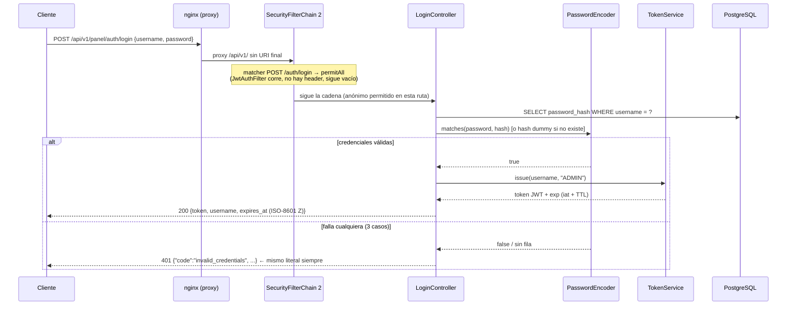
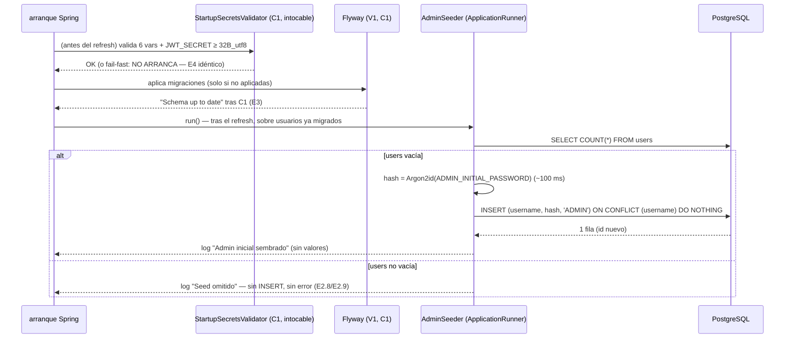

# Design — C2 · Seguridad base + auth del panel

> Fase sdd-design del flujo SDD para C2. Diseña **cómo** se cumple el spec
> (S1–S32, E2.1–E2.22) con las decisiones de gate aprobadas (G1–G5 de
> `proposal.md`, 5/5 el 2026-10-20). Los literales de API/BD/errores se
> **citan, nunca se redefinen** (regla del 07). Diseñado SOBRE el código
> real de C1 inspeccionado (`pom.xml`, `application.yml`,
> `StartupSecretsValidator`, `WebSocketConfig`, `EchoSocketHandler`,
> `compose.yaml`, `frontend/nginx.conf`, `V1__init.sql`, `.env.example`).

## 0. Resumen del diseño

C2 añade la capa de seguridad sobre el esqueleto de C1 con **10 ficheros
nuevos** en Java (más 5 de tests), y toca **exactamente 3 ficheros de C1**
(`pom.xml`, `application.yml`, `compose.yaml`). El pivote del diseño es la
inspección real del `compose.yaml` de C1: el contenedor backend **no recibe
`FRONTEND_ORIGIN`** en su `environment` — sin tocar esa línea, la config
CORS aprobada en G1 sería inoperante aunque se implemente. El `.env.example`
**no se toca**: TRD §6.3 (tabla autoridad) ya fijaba `JWT_TTL_HOURS` y
`FRONTEND_ORIGIN`, y el `.env.example` de C1 ya las documenta literalmente.

El diseño gira sobre 9 decisiones (CD-1…CD-9): las 3 `SecurityFilterChain`
con matchers exactos y un único escritor JSON de 401; el `AdminSeeder`
(ApplicationRunner sobre tabla vacía, literal Schema §6.3); `TokenService`
con jjwt 0.13.0 sobre bytes UTF-8 crudos; el `JwtAuthFilter` que no escribe
el 401 sino que deja fallar la autorización; el bean Argon2id OWASP 2024 con
BC explícito; los controllers con records y un 401 idéntico anti
user-enumeration; `CorsConfig` mínimo con origen opcional; el cableado de
configuración (bloque `projectlog` + `compose.yaml`) y el mapa de tests [L].

---

## 1. Arquitectura del cambio

### 1.1 Ficheros nuevos (backend/src/main/java/com/projectlog/)

```
backend/src/main/java/com/projectlog/
├── auth/                                  # package de C1 ya existe (package-info)
│   ├── PasswordConfig.java                # [N1]  bean PasswordEncoder (S6/S28)
│   ├── TokenService.java                  # [N2]  sign/parse HS256 (S11–S15)
│   ├── JwtAuthFilter.java                 # [N3]  OncePerRequestFilter (S5)
│   ├── JwtPrincipal.java                  # [N4]  record {username, role, expiresAt}
│   ├── AdminSeeder.java                   # [N5]  ApplicationRunner (S21–S23)
│   ├── LoginController.java               # [N6]  POST /api/v1/panel/auth/login (S17)
│   ├── MeController.java                  # [N7]  GET /api/v1/panel/me (S18)
│   ├── LoginRequest.java                  # [N8]  record {username, password}
│   ├── LoginResponse.java                 # [N9]  record {token, username, expires_at}
│   └── MeResponse.java                    # [N10] record {username, role, expires_at}
└── config/                                # package de C1 ya existe (package-info)
    ├── SecurityConfig.java                # [N11] 3 SecurityFilterChain + entry point (S1–S4)
    ├── RestAuthenticationEntryPoint.java  # [N12] escritor único del 401 JSON (S2/S5)
    └── CorsConfig.java                    # [N13] CorsConfigurationSource (S25/S26)
```

Los beans de `auth` son `@Component`/`@Configuration` escaneados por
`Application` (C1 ya escanea `com.projectlog.*` — no hay que tocarlo).
`RestAuthenticationEntryPoint` es un `@Component` en `config` reutilizado
por las tres cadenas (un solo escritor JSON = un solo formato `{code,
message}` en toda la API — Schema §3.1). `JwtPrincipal` (record) es el
principal que el filtro deposita en el `SecurityContext`; MeController lo
lee para S18 sin tocar BBDD.

### 1.2 Ficheros de C1 que se tocan (solo 3)

| Fichero | Cambio | Por qué |
|---|---|---|
| `backend/pom.xml` | +6 dependencias (CD-5/CD-8) `spring-boot-starter-security` (BOM), `org.bouncycastle:bcprov-jdk18on:1.86` (runtime), `jjwt-api/impl/jackson:0.13.0` (api compile, impl/jackson runtime), `spring-boot-starter-test` (test, BOM) | S7/S10/S27 |
| `backend/src/main/resources/application.yml` | (a) actualizar el comentario de cabecera C1 ("sin FRONTEND_ORIGIN (CORS es C2)" ya no es cierto); (b) añadir un bloque `projectlog.security` que mapea ${JWT_TTL_HOURS:8} y ${FRONTEND_ORIGIN:} a propiedades legibles (CD-7) | S13/S25; punto único de mapeo TRD §6.3 |
| `compose.yaml` | **+1 línea** en `backend.environment`: `FRONTEND_ORIGIN: ${FRONTEND_ORIGIN}` | Hallazgo de la inspección: C1 no pasa la variable al contenedor; sin ella S25/E2.17 son imposibles (env vacío siempre ⇒ CORS siempre cerrado, E2.17 nunca verde) |

### 1.3 Ficheros de C1 que NO se tocan (y por qué)

| Fichero | Estado | Ancla |
|---|---|---|
| `config/StartupSecretsValidator.java` + `META-INF/spring.factories` | intocables (javadoc incl.) — su javadoc ya reserva "firma JWT, seed del admin y SecurityFilterChain son C2" | S29/E2.14 |
| `db/migration/V1__init.sql` | intocable — C2 añade cero migraciones (E3); el seed es código, no SQL (Schema §6.3) | S24/S21 |
| `config/WebSocketConfig.java`, `streaming/EchoSocketHandler.java` | intocables — `/ws/logs` libre hasta C7 | S31/E2.13 |
| `frontend/nginx.conf`, `docker/Dockerfile`, `frontend/Dockerfile` | intocables — proxy E8 y builds intactos | S32/E2.15 |
| `.env.example` | **no se toca**: ya documenta `JWT_TTL_HOURS=8` y `FRONTEND_ORIGIN` con los nombres literales de la tabla TRD §6.3 (autoridad). G1 no cambia ningún nombre; la pieza que faltaba era el passthrough de compose (1.2), no la documentación | TRD §6.3 |
| `Application.java`, `package-info.java` | intocables — el escaneo cubre los beans nuevos | TRD §2.1 |
| `scripts/ws_echo_test.py` | intocable y re-ejecutado en cada paso (no-regresión E5–E7) | S31 |

### 1.4 `pom.xml` — dependencias nuevas exactas (G5/RG-1)

```xml
<!-- orden en <dependencies>: tras las existentes de C1, sin reordenar -->
<dependency>spring-boot-starter-security</dependency>            <!-- BOM 3.5.16, sin versión -->
<dependency>org.bouncycastle:bcprov-jdk18on:1.86</dependency>     <!-- scope runtime -->
<dependency>io.jsonwebtoken:jjwt-api:0.13.0</dependency>          <!-- compile (default) -->
<dependency>io.jsonwebtoken:jjwt-impl:0.13.0</dependency>         <!-- scope runtime -->
<dependency>io.jsonwebtoken:jjwt-jackson:0.13.0</dependency>      <!-- scope runtime -->
<dependency>spring-boot-starter-test</dependency>                 <!-- scope test, BOM -->
```

Notas: `spring-boot-starter-jdbc` ya está presente por C1 (comentario del
pom) — el `JdbcTemplate` del seed y del login no añade dependencia. BC en
`runtime` porque el código propio no compila contra clases de BC (el
`Argon2PasswordEncoder` delega en `Argon2BytesGenerator` en runtime); el
árbol queda `spring-security-crypto` (opcional BC) + BC real. Se actualiza
el comentario del bloque `<dependencies>` para eliminar la frase
"Deliberadamente SIN spring-boot-starter-test (los tests llegan en C2)",
que dejaría de ser verdad.

---

## 2. Decisiones de diseño (CD-1…CD-9)

### CD-1 · Tres `SecurityFilterChain` con matchers exactos (S1–S4)

`SecurityConfig` define tres beans `@Bean SecurityFilterChain` con
`@Order(1)`, `@Order(2)` y `@Order(3)`:

| Cadena | Matcher | Reglas |
|---|---|---|
| 1 `@Order(1)` | `securityMatcher("/api/v1/ingest/**")` | `anyRequest().denyAll()` + entry point JSON 401. Sin `cors()` (TRD §5: "sus clientes son servicios"). Mecanismo `X-API-Key` llegará en C5; aquí solo declara reject. |
| 2 `@Order(2)` | `securityMatcher("/api/v1/panel/**")` | `csrf(disabled)`, `sessionManagement(STATELESS)`, `cors(withDefaults())` (fuente de CD-7), `addFilterBefore(jwtAuthFilter, UsernamePasswordAuthenticationFilter.class)`, sin `httpBasic` ni `formLogin`; reglas: `requestMatchers(HttpMethod.POST, "/api/v1/panel/auth/login").permitAll()` y `anyRequest().authenticated()`; entry point JSON 401. |
| 3 `@Order(3)` | sin matcher (resto) | `requestMatchers("/actuator/health", "/actuator/info", "/ws/logs").permitAll()` + `anyRequest().denyAll()` + entry point JSON 401. |

Rationale de cada regla:

- **allowAll solo en el POST login exacto** (método+ruta): un matcher de
  solo ruta (`/api/v1/panel/auth/login`) dejaría público `GET` sobre la
  misma URL y cualquier sub-ruta (`/auth/login/**`). Con
  `HttpMethod.POST` + ruta literal, S3 se cumple en su texto exacto
  ("solo el login exacto"). Lo público queda reducido a la superficie
  mínima que el AppFlow flujo 1 necesita en C8.
- **El resto de la cadena 2 es `authenticated()`** y no
  `hasRole("ADMIN")`: ADR-14 ("role sin uso real") y Schema §5 ("todo lo
  autenticado por JWT está autorizado") — añadir un check por rol aquí
  adelantaría C3+ y contradeciría el ADR (S20).
- **Entry point JSON compartido** (`RestAuthenticationEntryPoint`, CD-4):
  las tres cadenas lo obtienen por constructor. Sin él, la cadena 1
  (denyAll anónimo) y la 3 responderían con el 403 vacío por defecto
  (`Http403ForbiddenEntryPoint`), y S2 exige 401 con cuerpo estándar.
  Adjuntarlo también a la cadena 3 hace que "cualquier ruta no cubierta"
  responda 401 JSON (E2.15 admite 401/403 "sin contenido"; el 401 JSON es
  el más limpio y uniforme).
- **`anyRequest().denyAll()` en la cadena 3 no rompe el Echo WS ni los
  healthchecks** porque (`a`) `/ws/logs` está permitido explícitamente
  *antes* de `anyRequest()` dentro de la MISMA chain (las reglas se
  evalúan en orden de declaración) y (`b`) el healthcheck de compose hace
  `curl http://127.0.0.1:8080/actuator/health` — ruta permitida. El
  `/actuator/env` sigue siendo 404 por doble causa: no está en
  `exposure.include` (application.yml intacto) y, aun si se expusiera,
  `denyAll` lo bloquearía (E10).
- **Cadena 1 declarada y no usada** (S2/E2.16): `denyAll` responde 401 vía
  entry point para usuarios anónimos (ExceptionTranslationFilter traduce
  el `AccessDeniedException` de un anónimo a la invocación del entry
  point). Para un hipotético principal autenticado se registra también el
  mismo entry point como `accessDeniedHandler` — defensa en profundidad
  que garantiza **nunca 403 HTML** en la superficie declarada.
- **`@Order(3)` sin matcher**: Spring Security exige una chain
  incondicional como último recurso; con matchers exactos en 1 y 2, la 3
  cubre todo lo demás y hace que "protegido por defecto" sea el estado
  inicial del monolito (C3–C6 nacen behind 401, S19).

### CD-2 · `AdminSeeder`: ApplicationRunner + JdbcTemplate (S21–S23)

`@Component public class AdminSeeder implements ApplicationRunner` en
`auth`. Orden de arranque garantizado por Boot sin configuración extra:
runners corren **después** del refresh del contexto, y Flyway se aplica
dentro de ese refresh (`FlywayMigrationInitializer` como dependencia
explícita del arranque JDBC) → el orden real es validador
(EnvironmentPostProcessor, antes del refresh) → refresh (Flyway V1) →
runner. No se necesita `@Order` ni dependencia explícita sobre Flyway.

Lógica (semántica literal Schema §6.3, gate G4):

```
run():
  long n = jdbcTemplate.queryForObject("SELECT COUNT(*) FROM users", Long.class);
  if (n > 0) { log.info("Seed omitido: users no está vacía ({} filas)."); return; }  // g4
  String hash = passwordEncoder.encode(env.getProperty("ADMIN_INITIAL_PASSWORD"));
  jdbcTemplate.update("""
      INSERT INTO users (username, password_hash, role)
      VALUES (?, ?, 'ADMIN')
      ON CONFLICT ON CONSTRAINT users_username_unique DO NOTHING
      """, env.getProperty("ADMIN_INITIAL_USERNAME"), hash);
  log.info("Admin inicial sembrado (users vacía).");   // sin valores, sin hash
```

- **Condición global tabla-vacía** (`SELECT COUNT(*)`), no por-username:
  divergencia Schema §6.3 vs TRD §5 resuelta por G4. Consecuencia
  documentada: cambiar `ADMIN_INITIAL_USERNAME` tras el primer seed no
  crea un segundo admin (E2.9).
- **`ON CONFLICT DO NOTHING` sobre `users_username_unique`** es segunda
  barrera de idempotencia (reinicio concurrente/re-invocación); la primera
  es el COUNT. Con 1 admin ambas caídas producen exactamente 1 fila
  (E2.8). El nombre del constraint es literal de `V1__init.sql`.
- **`role='ADMIN'` explícito** en el INSERT (S21): el DEFAULT del esquema
  lo cubre; fijarlo elimina dependencia del default (E2.22).
- **Argon2 en arranque**: una sola llamada `encode()` (~100 ms con
  m=19456 KiB, t=2, p=1) *solo* cuando la tabla está vacía. Reinicio
  normal: coste 0 (COUNT + 0 hashes). Aceptable por definición de seed.
- **No re-valida presencia** (S23): lee `ADMIN_INITIAL_PASSWORD` y hashea;
  sin password el proceso nunca llega aquí (el validador de C1 aborta
  antes del refresh — E4 idéntico, E2.10).
- **Nunca en SQL/Flyway**: el hash depende de configuración (Schema §6.3
  literal); V1 queda intacto (E2.22 en frío: "Schema up to date").
- Logs sin valores: el seeder reporta "sembrado" u "omitido", jamás
  username ni hash (misma higiene que S16/E2.19).

### CD-3 · `TokenService` con jjwt 0.13.0 (S10–S15)

`@Component TokenService` en `auth`; constructor recibe
`jwtSecret` (string crudo) y `ttlHours` (long) del bloque
`projectlog.security` (CD-7).

- **Clave HMAC** (S11):
  `new SecretKeySpec(jwtSecret.getBytes(StandardCharsets.UTF_8), "HmacSHA256")`
  — bytes UTF-8 crudos, exactamente las mismas unidades que mide el
  validador de C1 (≥32 bytes UTF-8, no Base64). No se introduce Base64 ni
  HKDF: una sola convención de derivación en el sistema.
- **Sign** (`String issue(String username, String role)`):
  `Jwts.builder().subject(username).claim("role", role)
  .issuedAt(Date.from(Instant.now())).expiration(Date.from(iat.plus(ttl)))
  .signWith(secretKey, Jwts.SIG.HS256).compact()`. Claims exactamente
  `{sub, role, iat, exp}` (S12, conjunto cerrado — sin `jti`, sin `iss`).
- **TTL** (S13): `ttlHours` leído de `JWT_TTL_HOURS` con **defecto 8**
  aplicado en application.yml (`${JWT_TTL_HOURS:8}`); `exp = iat + TTL`.
  `expires_at` de las respuestas se deriva del `exp` del token (ver CD-6).
- **Parse/verify** (`Optional<JwtPrincipal> verify(String token)`):
  `Jwts.parser().verifyWith(secretKey).build().parseSignedClaims(token)`
  envuelto en try/catch de `JwtException` e `IllegalArgumentException`
  (subclases `SignatureException`/`MalformedJwtException`/
  `ExpiredJwtException` incluidas) → devuelve vacío ante **cualquier**
  fallo; el filtro no distingue causa (S5: un solo literal).
- **Sin clock-skew** (S14): jjwt 0.13 tiene `allowedClockSkewSeconds = 0`
  por defecto — el diseño **no** invoca `clockSkewSeconds(...)`, y lo deja
  comentado en el código como decisión (reloj host NTP del TRD §9, red
  interna con un único firmante; añadir margen solo amplía la ventana).
- **API 0.13.0** (no la 0.12 des-deprecada): solo superficie no deprecada
  — `Jwts.SIG.HS256` para el algoritmo, `parser().verifyWith(...)`,
  `parseSignedClaims(...)`; `jjwt-impl` queda en runtime y **ningún import
  de `io.jsonwebtoken.impl.*` aparece en fuentes** (S10). Superficie
  compilable = `jjwt-api` solamente.
- **Cambio de secreto** (S15): como la clave se reconstruye en cada
  arranque desde el env, cualquier rotación de `JWT_SECRET` invalida de
  facto los tokens previos (falla la firma en `verify`). Re-login, aceptado
  en v1 (Schema §5).
- El servicio **no loguea** nada (S16): ni debug con el token, ni mensajes
  con el header.

### CD-4 · `JwtAuthFilter` y el punto donde se escribe el 401 (S5)

`@Component OncePerRequestFilter` en `auth`, registrado **solo** en la
cadena 2 (no es bean global: `doFilter` no lo excluye, pero al declararse
`addFilterBefore` dentro de la chain 2 el filtro no ve tráfico de las
cadenas 1 y 3 — superficie mínima).

Flujo por petición de panel:

1. Header `Authorization` presente y con prefijo exacto `"Bearer "` →
   extraer el resto (token crudo, sin trim agresivo) → `tokenService.verify(token)`.
2. **Válido** → construir
   `UsernamePasswordAuthenticationToken(principal=new JwtPrincipal(sub,
   role, exp), credentials=null, authorities=List.of())` y establecer el
   `SecurityContextHolder`; continuar la cadena. Autoridades vacías: sin
   checks por rol (CD-1, S20).
3. **Ausente/malformado/inválido/expirado** → el filtro **NO** escribe
   respuesta y **NO** setea contexto: continúa la cadena vacía. La regla
   `anyRequest().authenticated()` falla y `ExceptionTranslationFilter`
   (usuario anónimo) invoca el **entry point** (CD-1) que escribe el 401.

Rationale: **un solo punto escribe el 401** (el entry point), con un único
literal `invalid_token` (S5) y un mensaje genérico ("Autenticación
requerida") idéntico para los cuatro casos — no hay oráculo de cuál falló
ni subtipos (S5/TRD §2.5). El filtro tampoco necesita objeto `Response`,
lo que simplifica E2.4/E2.6 con MockMvc y garantiza que **nunca** haya
403 HTML en el panel.

`RestAuthenticationEntryPoint` (`config`, N12): `AuthenticationEntryPoint`
que escribe JSON con `ObjectMapper` — status 401, `Content-Type:
application/json`, cuerpo `{"code": "invalid_token", "message":
"Autenticación requerida"}`; mismo formato `{code, message}` que usará el
401 de login (Schema §3.1 estándar, campo `field?` no aplicable aquí).
`commence()` no lee ni loguea el header (S16).

### CD-5 · Bean `PasswordEncoder` Argon2id + BC runtime (S6–S9, E2.20)

`PasswordConfig` (`auth`, N1):

```java
@Bean PasswordEncoder passwordEncoder() {
    return new Argon2PasswordEncoder(16, 32, 1, 19456, 2);  // salt, hash, p, m(KiB), t — OWASP 2024
}
```

- **Constructor explícito**, no
  `Argon2PasswordEncoder.defaultsForSpringSecurity_v5_8()` (m=16384 ≠
  OWASP 2024 — S6). Produce PHC
  `$argon2id$v=19$m=19456,t=2,p=1$…`, exactamente lo que el comentario de
  `V1__init.sql` ("Hash Argon2id (formato PHC)") espera (S8/E2.20/E2.22).
- **BC explícito en runtime** resuelve issue spring-security #8842
  (dependencia *optional*): sin `bcprov-jdk18on` el primer `encode()` en
  runtime lanzaría `NoClassDefFoundError`. El design lo cubre con E2.20
  **temprano** (paso 3 del plan): el riesgo #1 del 06 se desactiva en este
  corte, no al final. Plan B si E2.20 fallara (S9):
  `de.mkammerer:argon2-jvm` envuelto en un `PasswordEncoder` propio
  manteniendo el PHC en BBDD **idéntico** — la BBDD no cambia en ningún
  plan, solo el bean.
- Comparación siempre `encoder.matches(raw, password_hash)` — nunca hashear
  y comparar strings (S8). El PHC autodescribe parámetros: `matches`
  seguirá OK si el bean evoluciona (S8).

### CD-6 · `LoginController` / `MeController` + records (S17–S19, E2.1/E2.2/E2.5)

- `LoginRequest` record `{username, password}` — sin anotaciones de
  validaciónBean (la semántica de error es siempre el MISMO 401).
- `LoginController`:
  1. Consulta JdbcTemplate `SELECT password_hash FROM users WHERE
     username = ?` (limitada por `users_username_unique`).
  2. `encoder.matches(password, hash)`; si no existe el usuario o el
     match falla → mismo camino: **401** `{"code":
     "invalid_credentials", "message": "…"}` (S17, idéntico literal).
     Hardening anti-enum de tiempo: ante usuario inexistente se ejecuta
     `matches` contra un hash dummy constante de la clase para igualar el
     coste de ambas ramas (misma latencia, mismo 401).
  3. OK → `token = tokenService.issue(username, "ADMIN")`; `expires_at`
     = `exp` del token **derivado sin re-derivar**: `TokenService.issue`
     devuelve el token y su `Instant exp` (iat+TTL) juntos; el formato es
     ISO-8601 UTC con sufijo `Z` literal, producida con
     `DateTimeFormatter` en `ZoneOffset.UTC` y patrón
     `yyyy-MM-dd'T'HH:mm:ss'Z'` — salida determinista siempre con `Z` y
     precisión de segundos (Schema §3.1, E2.1 sin milisegundos sorpresa).
     → **200** `LoginResponse{token, username, expires_at}` (roles sin
     DB-roundtrip extra de /me; login sí consulta DB porque valida el
     password — eso es su cometido).
  4. **Cuerpo malformado** → JSON no parseable
     (`HttpMessageNotReadableException`) o campos nulos:
     `@ExceptionHandler` en el propio controller → **401**
     `invalid_credentials` (S17 exige el mismo par 401/literal para cuerpo
     malformado, no el 400 por defecto de Boot).
- `MeResponse` record `{username, role, expires_at}`; `MeController`:
  lee `Authentication` del `SecurityContext`, castea el principal a
  `JwtPrincipal` y responde **200** `MeResponse{username, role,
  expiresAt}` — `role` y `expires_at` salen de los claims del token
  (S18), **sin consulta BBDD**. Sin sesión, sin usuario de DB: si el admin
  cambia de password, el token sigue válido hasta `exp` (Schema §5
  literal, cerrado de sesión local).
- `JwtPrincipal` (N4) es el puente: `{username, role, expiresAt:Instant}`.
  `expires_at` de /me se formatea con el mismo formatter que login
  (idéntico formato `Z`, E2.5).
- Resto de `/api/v1/panel/**` sin controllers (C3–C6): la regla
  `authenticated()` + filtro bastan → 401 `invalid_token` (S19/E2.3); el
  proxy entrega ese 401 JSON y no el index del SPA porque la ruta va bajo
  `/api/v1/` (nginx E8 intacto).

### CD-7 · `CorsConfig` mínimo + cableado de env (S25/S26, G1)

- `CorsConfig` (`config`, N13) expone
  `@Bean CorsConfigurationSource`:
  - Inyecta `frontendOrigin` (string, valor de `projectlog.security.
    frontend-origin`, **vacío si falta**).
  - `UrlBasedCorsConfigurationSource`; si el origen **no está en blanco**,
    registra config para `"/**"` (el matcher de la cadena 2 ya limita el
    efecto a `/api/v1/panel/**` — así se cumplen S25 y la decisión G1
    sin duplicar la ruta): `setAllowedOrigins(List.of(origin))` — **nunca
    `*`, nunca `allowedOriginPatterns`**; `setAllowedMethods(GET, POST,
    PATCH, DELETE, OPTIONS)`; `setAllowedHeaders("Authorization",
    "Content-Type", "X-Confirm-*")` (los `X-Confirm-*` se reservan para
    C3/P1 según la propuesta); `setAllowCredentials(false)` (el JWT va
    por header, no cookies); `setMaxAge(3600L)` (menos prefights en dev).
  - **Si `FRONTEND_ORIGIN` falta** (S26): se registra **cero**
    configuración — la fuente queda sin orígenes ⇒ ninguna respuesta
    lleva cabeceras CORS ⇒ CORS cerrado por defecto (E2.18). `cors()` en
    la cadena 2 es inerte, y el mismo-origen por proxy (prod, TRD §6.2)
    ni lo nota. La API de ingesta (cadena 1) nunca recibe `cors()` ⇒ sin
    CORS abierto, TRD §5.
- **application.yml** (toque 1.2): bloque nuevo —

  ```yaml
  projectlog:
    security:
      jwt-ttl-hours: ${JWT_TTL_HOURS:8}        # defecto 8 (TRD §6.3, S13)
      frontend-origin: ${FRONTEND_ORIGIN:}     # opcional: falta ⇒ CORS cerrado (S26)
  ```

  Más el comentario de cabecera actualizado. Rationale del bloque: punto
  único de mapeo de nombres env→propiedades (los nombres vienen de la
  tabla TRD §6.3, autoridad), defaults visibles en una sola línea, y
  overridable por tests [L] sin tocar el entorno (E2.18). `jwtSecret` NO
  entra en yml: `TokenService` lo lee con `@Value("${JWT_SECRET}")` —
  obligatorio (validador C1 lo garantiza) y jamás debería quedar
  sugerido/default-izado en un fichero versionado.
- **compose.yaml** (toque 1.2): `FRONTEND_ORIGIN: ${FRONTEND_ORIGIN}` en
  `backend.environment`. Es el único cambio de infra necesitado por G1 y
  **no registra ningún riesgo**: la variable es opcional para el
  validador (C1 la excluye por design del fail-fast) y para compose la
  interpolación con la var ausente produce cadena vacía — comportamiento
  idéntico a "sin CORS" (S26).

### CD-8 · Cableado de dependencias y compatibilidad C1 (S7/S10/S27)

Cubiertos en §1.4. Dos notas operativas: (a) `spring-boot-starter-security`
registraría por defecto el usuario aleatorio con contraseña impresa en
logs — al no declarar `httpBasic`/`formLogin` y no definir un
`UserDetailsService`, Boot 3.5 **no** genera ese usuario si no hay
`AuthenticationManager` basado en users in-memory; con esta config el
"user aleatorio" queda inerte igualmente (S3) — y el mensaje
"Using generated security password" no debe aparecer: si apareciera en
logs, es señal de config mal conectada (chequeo manual en el smoke E2.1).
(b) `SessionCreationPolicy.STATELESS` no rompe el WS de C1: el handshake
de `/ws/logs` corre bajo la cadena 3, que no cambia nada del
`WebSocketConfig` (S31).

### CD-9 · Mapa de tests [L] (G3, sin Testcontainers — §6 del spec)

Viven en `backend/src/test/java/com/projectlog/…`; `spring-boot-starter-test`
(scope test, BOM) aporta JUnit 5 + AssertJ + MockMvc + Mockito
(`@MockitoBean`, reemplazo de `@MockBean` en Boot 3.5).

| Escenario | Clase de test | Mecanismo |
|---|---|---|
| E2.20 | `auth/Argon2PasswordTest.java` | Unit puro sin Spring: instancia `new Argon2PasswordEncoder(16,32,1,19456,2)`; aserciones sobre el prefijo PHC, `matches` true/false, dos `encode` con salts distintas |
| E2.21 | `auth/TokenServiceTest.java` | Unit puro: `new TokenService(SECRETO_TEST_≥32UTF8, ttl)`; sign→parse roundtrip; claims exactos {sub, role, iat, exp} y solo esos; `exp = iat + TTL` con default 8 y TTL alterno (p. ej. 1 h); firma alterada y token expirado (ttl negativo o token manipulado) rechazados por `verify` |
| E2.4 [L] / E2.6 | `auth/PanelAuthMvcTest.java` | `@WebMvcTest(MeController.class)` + `@Import({SecurityConfig.class, RestAuthenticationEntryPoint.class, CorsConfig.class})` + `@MockitoBean TokenService` (y controller Login si se quieren también E2.2-lite): MockMvc — sin header → 401 JSON `{code:"invalid_token"}` (no HTML); `Bearer` con firma alterada (verify vacío mockeado) → 401; token expirado (verify vacío con mensaje expirado) → 401. Comprueba también que el 401 del panel nace del entry point (content-type JSON) |
| E2.19 | `auth/LogHygieneTest.java` | Appender de `ch.qos.logback.classic` (ListAppender) sobre el logger de JwtAuthFilter/RestAuthenticationEntryPoint/TokenService dentro de `PanelAuthMvcTest`: ninguna línea contiene `Authorization`, `Bearer` ni el JWT |
| E2.18 | `config/CorsConfigTest.java` | Unit: `CorsConfig` con origen vacío → `UrlBasedCorsConfigurationSource` sin configuraciones registradas (`getCorsConfiguration(req)` nulo para cualquier origin); con origen seteado → origen reflejado sin `*`, credenciales false, headers/métodos exactos |
| E2.2 [componente] | `auth/LoginCredentialsTest.java` | `@WebMvcTest(LoginController.class)` + `@MockitoBean JdbcTemplate`/encoder/service: usuario inexistente, password mal y cuerpo malformado → 401 con el MISMO literal `invalid_credentials` (anti user-enumeration verificado en [L]; E2.2 [S] lo confirma en la pila) |

No se usan `@SpringBootTest` (exigiría DataSource/Flyway/admin ⇒ es terreno
de los smokes [S] y, con BBDD real, de C3). No se crean
`src/test/resources/application.yml`: el slice @WebMvcTest no levanta
Flyway/DataSource y el yml de main es suficiente; si un placeholder
resoluble-chocara, la solución prevista es un `application-test.yml`
mínimo, decidido al escribir el test — no se anticipa aquí.

Smokes [S] (E2.1/2/3/5/7/8/9/10/11/12/13/14[S]/15/16/17/22): contra la pila
podman con el flujo canónico de C1; las órdenes concretas se desglosan en
`tasks.md`, no aquí.

---

## 3. Diagramas

### 3.1 Flujo de login



### 3.2 Request a `/api/v1/panel/**` (sin y con JWT)

```mermaid
flowchart TD
    A[Request a /api/v1/panel/**] --> B{Authorization empieza con Bearer?}
    B -- no --> G[SecurityContext vacío]
    B -- sí --> C[JwtAuthFilter: tokenService.verify]
    C -- válido --> D[SecurityContext = JwtPrincipal sub/role/exp] --> E
    C -- inválido/expirado --> G
    G --> E{Regla: authenticated?}
    D --> E
    E -- no autenticado --> F[ExceptionTranslationFilter → RestAuthenticationEntryPoint] --> H[401 JSON {code: invalid_token, message}]
    E -- autenticado --> I[Controller: /me o futuras rutas C3+]
    I -- /me --> J[200 {username, role, expires_at} desde JwtPrincipal]
```

Y el flujo de login entra por el mismo `SecurityFilterChain 2` con la regla
`POST /api/v1/panel/auth/login → permitAll` (sin filter que autentique).

### 3.3 Seed idempotente en arranque



---

## 4. Impacto en C1 (no-regresiones protegidas por el diseño)

| Escenario C1 en riesgo por añadir spring-security | Cómo lo protege el diseño |
|---|---|
| **E1** — healthcheck en bucle (`restart: unless-stopped`) | Cadena 3 con `/actuator/health` y `/actuator/info` permitAll explícitos (CD-1); el healthcheck de compose hace `curl http://127.0.0.1:8080/actuator/health` — GET sin auth. E2.11 es paso obligatorio del plan tras cada cambio de cadenas |
| **E4** — fail-fast del validador | `StartupSecretsValidator` y `spring.factories` **intocables** (1.3); C2 no añade ni relaja variables (S29). E2.10/E2.14 verifica mensaje y código de salida idénticos a C1 |
| **E5–E7** — Echo WS `/ws/logs` + idle 75 s | `/ws/logs` permitAll en la cadena 3 (CD-1, G2); el handshake llega por el proxy nginx intacto; `WebSocketConfig`/`EchoSocketHandler` sin cambios. `ws_echo_test.py` re-ejecutado en cada paso (E2.13) |
| **E10** — `/actuator/env` 404 | `exposure.include: health,info` intacto (application.yml) + `anyRequest().denyAll()` de la cadena 3 como segunda barrera (CD-1). E2.12 |
| **E8/E9** — proxy `/api/v1/` JSON | `frontend/nginx.conf` intocable; el 401 del filtro/entry point es JSON — una ruta inexistente bajo `/api/v1/panel/` responde 401 JSON, no el index del SPA (E2.15) |
| **E2** — único puerto host 8080 | compose sólo añade una variable de entorno; puertos/red/volumen sin cambios |
| **E3** — Flyway "Schema up to date" en frío | C2 añade cero migraciones (1.3); el seed corre después del refresh como código (CD-2). E2.22 |
| **RG-1** — versiones exactas sin rangos | `bcprov-jdk18on:1.86` y `jjwt-*:0.13.0` literales (G5); `starter-security/test` sin versión porque el BOM de Boot 3.5.16 los gestiona — mismo patrón que C1 (§1.4) |
| **RG-6** — estabilidad de la pila | Cadena 1 y 3 con entry point JSON (sin 403 HTML anómalo), STATELESS (sin sesiones que rompan compose), sin dependencia nueva que arranque otro auto-config pesado |

---

## 5. Riesgos de diseño y mitigación

| # | Riesgo | Mitigación en el diseño |
|---|---|---|
| 1 | **BC/Argon2** (issue spring-security #8842): `Argon2PasswordEncoder` delega en Bouncy Castle, dependencia *optional* → `NoClassDefFoundError` en runtime sin BC | `bcprov-jdk18on:1.86` explícito en runtime scope (§1.4, CD-5) + E2.20 (unit PHC+matches) ejecutable **temprano** en el plan, no al final. Plan B acotado (S9): envolver otra librería madura manteniendo el PHC de `users.password_hash` idéntico — la BBDD no cambia |
| 2 | **Coste Argon2 en arranque/login** | ~100 ms por hash (m=19456 KiB, t=2, p=1): *una vez* en la vida de un despliegue limpio (solo si tabla vacía), y por login correcto. Login fallido con password mal ≈ mismo coste (intencional, iguala tiempo). Inaceptable sólo si se sembrara en bucle — el COUNT evita re-hashing en cada reinicio (CD-2) |
| 3 | **jjwt 0.13.0 API distinta de 0.12.x** (paquetes/métodos reorganizados) | El design fija la superficie no deprecada y completa (`Jwts.SIG.HS256`, `parser().verifyWith(...)`, `parseSignedClaims`), prohíbe imports de `io.jsonwebtoken.impl.*` (S10) y hace E2.21 un unit que corre en segundos: cualquier desvío de API se detecta en compilación, no en la pila |
| 4 | **CORS en C8-dev sin frontend aún** — no hay frontend real que pruebe E2.17 | El frontend C1 ya sirve el index placeholder por nginx mismo-origen — el CORS real solo se notará con dev-server en C8. E2.17 se valida con `curl` (`Origin:` y `OPTIONS /auth/login`) contra la pila, suficiente para verificar el bean; C8 no re-toca SecurityConfig (razón por la que G1 aprobó hacerlo en C2) |
| 5 | **Semántica expiración /me vs token** | `expires_at` de /me viene del claim `exp` del token, no de re-consulta: si el token expiró, el 401 del entry point responde antes de llegar al controller; /me nunca puede contradecir al filtro. Comportamiento v1 aceptado: cambiar password no revoca tokens activos (Schema §5; sin logout/refresh) |
| 6 | **Cadena 3 `denyAll` demasiado agresiva** (rompería un recurso futuro olvidado) | Deliberado: "protegido por defecto" es el estado inicial correcto del monolito (S19; C3–C6 nacen behind 401). Cuando C7 necesite `/ws/logs` authed o C5 la ingesta, amplían **su** cadena — no se relaja la 3 |
| 7 | **`expires_at` con formato inconsistente** (Instant.toString() elide milisegundos/precision) | Formatter explícito en UTC con patrón `yyyy-MM-dd'T'HH:mm:ss'Z'` compartido por login y /me (CD-6): salida literal Schema §3.1 siempre con `Z`, sin milisegundos variables |
| 8 | **FRONTEND_ORIGIN ausente** en despliegues antiguos de C1 | Deja de fallar: compose interpola cadena vacía, el bean no registra orígenes, CORS cerrado (S26). Ninguna ruta de regresión: C1 en producción es mismo-origen vía proxy (TRD §6.2), CORS le es indiferente |

---

## 6. No-decisiones (explícitamente para C3–C8; este diseño no las anticipa)

- **C3/C4/C6** — controllers de proyectos, API keys y consulta de logs: en
  C2 no existen; nacen behind 401 bajo la cadena 2 (S19). El
  `JwtPrincipal` ya entrega sub/role a cualquier controller futuro.
- **C5** — mecanismo real de ingesta `X-API-Key` (hash SHA-256, índice
  O(1), `MessageDigest.isEqual`, 400/403/413/202): la cadena 1 queda
  declarada deny-by-default; C5 **puede** revisar el literal `invalid_token`
  del 401 de esa cadena si conviene a servicios cliente (nada lo consume
  hoy, E2.16 sólo exige 401).
- **C7** — auth del WebSocket (`/ws/logs?token=<JWT>` en el handshake,
  ADR-6/TRD §2.8), heartbeat (`WS_HEARTBEAT_SECONDS`), sustitución del
  handler por `LogSocketHandler` y CORS sobre `/ws/logs`: este design
  **no** toca WebSocketConfig ni la cadena 3 para WS. ADR-14 (rol) y el
  permiso por-query-param de C7 quedan como justificación ya asentada: ADR-14
  reserva que el socket se autentique por JWT vía query-param, decisión del
  TRD §2.8 que este corte no reabre.
- **C8** — login frontend (AppFlow flujo 1), router guard con `/me`,
  consumo del literal `invalid_token`/`invalid_credentials`, y el dev-server
  de Vite con `FRONTEND_ORIGIN` real (el 401 del AppFlow reacciona al
  status, no al `code`).
- **Logout/refresh** — no existen (Schema §5); el cierre es local.
- **Autorización por recurso** — sin checks por rol (ADR-14).
- **Rate limiting / límites por ventana** — no en v1 (429 no existe);
  límites por petición de ingesta: C5.
- **Testcontainers/BBDD en tests** — diferidos a C3 (primera vez que un
  test necesite PostgreSQL). Este design define los tests [L]
  explícitamente sin BBDD.
- **TLS/dominio** — HTTP plano en LAN (ADR-23).

### Literales citados (no redefinidos) por este design

- `POST /api/v1/panel/auth/login` → **200** `{token, username, expires_at}`
  · **401** `{"code": "invalid_credentials", …}` (Schema §3.2/§3.3,
  TRD §2.5).
- `GET /api/v1/panel/me` → **200** `{username, role: "ADMIN", expires_at}`
  · **401** cuerpo del filtro (Schema §3.3).
- Literal del 401 del filtro: **`invalid_token`**, único para
  ausente/expirado/inválido (decisión de propuesta aprobada — Schema §5
  exige cuerpo estándar sin fijar el `code`).
- Cuerpo de error estándar `{code, message, field?}`; fechas ISO-8601 UTC
  sufijo `Z`; 429 no existe (Schema §3.1).
- JWT: HS256; `JWT_SECRET` ≥32 bytes UTF-8; TTL 8 h (`JWT_TTL_HOURS`,
  defecto 8, GATE 2026-10-19); claims cerrados `sub, role, iat, exp`; sin
  refresh/logout (Schema §5, ADR-13).
- Contraseñas: Argon2id, parámetros OWASP 2024, PHC en BBDD, vía Spring
  Security (ADR-3, TRD §5) — comentario literal de `V1__init.sql`.
- Tabla `users`: columnas/constraint literales de `V1__init.sql`
  (`users_username_unique`, `role` DEFAULT 'ADMIN', timestamps NOT NULL).
- Seed: "si no existe ningún `users`, crea el admin con `username` =
  `ADMIN_INITIAL_USERNAME` y `password_hash` = Argon2id
  (`ADMIN_INITIAL_PASSWORD`)" (Schema §6.3; divergencia TRD §5 "el
  usuario" resuelta por G4 a favor del Schema — registrada para la próxima
  validación de docs).
- Env: nombres `JWT_SECRET`, `JWT_TTL_HOURS`, `ADMIN_INITIAL_*`,
  `FRONTEND_ORIGIN` — tabla TRD §6.3 (autoridad para decidir que
  `.env.example` no se toca).
- CORS: restricción estricta al origen del frontend, nunca en ingesta, sin
  wildcard (TRD §5; Schema §5); prod mismo-origen por proxy (TRD §6.2).
- Heredados C1: validador intocable; exposure `health,info`; proxy
  `/api/v1/` sin URI final; versiónes exactas RG-1; ADR-5 (WS nativo sin
  SockJS); ADR-23 (HTTP plano).