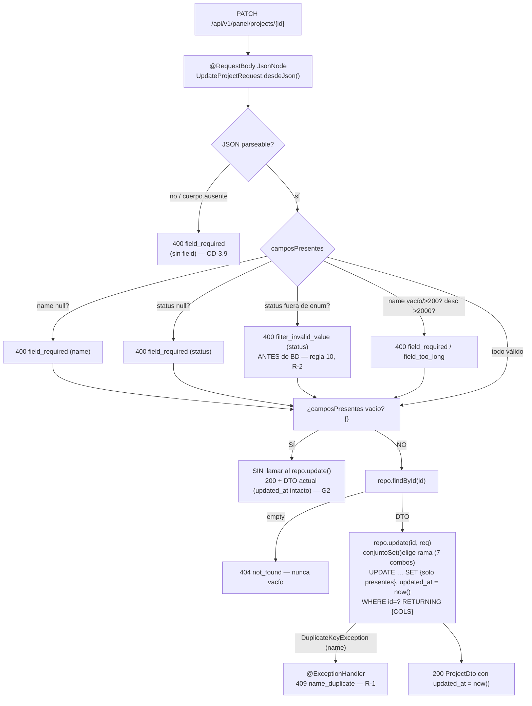
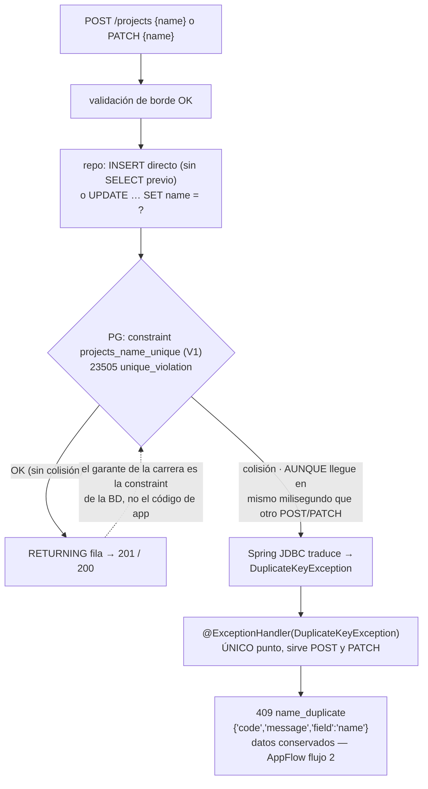

# Design — C3 · Proyectos: CRUD + archivado

> Fase sdd-design del flujo SDD para C3. Diseña **cómo** se cumple el spec
> (R3.1–R3.20, E3.1–E3.26) con las decisiones de gate aprobadas (G1–G5 de
> `proposal.md`, 5/5 el 2026-10-21). Los literales de API/BD/errores se
> **citan, nunca se redefinen** (regla del 07). Diseñado SOBRE el código real
> de C1+C2 inspeccionado (no modificado): `LoginController`/`MeController`
> (JdbcTemplate, records con nombres snake_case, `ObjectMapper`, formatter
> público), `SecurityConfig` (cadena 2 con matcher `/api/v1/panel/**`),
> `PanelAuthMvcTest` (fixture `@WebMvcTest` + cadena importada + JWT de
> prueba), `V1__init.sql` (tabla `projects` íntegra), `pom.xml` (sin
> starter-validation ni JPA), `frontend/{nginx.conf,Dockerfile,vite.config.ts}`
> y `compose.yaml` (proxy + pipeline `public/`→`dist/`), mockups
> `docs/mockups/04|05` y `scripts/qa_c2_smoke.sh`.

## 0. Resumen del diseño

C3 se limita a **añadir**: 8 ficheros nuevos de backend (5 main + 3 test, todos
en `com.projectlog.projects`), 2 copias adaptadas en
`frontend/public/mockups/` y 1 script de smoke `scripts/qa_c3_smoke.sh`.
**CERO ficheros de C1/C2 modificados** — la inspección real lo permite:

- La **cadena 2** de `SecurityConfig` hace `anyRequest().authenticated()` bajo
  `/api/v1/panel/**`: los 4 endpoints **nacen protegidos** sin tocar una línea
  (S19 de C2 ya lo comprobó contra `GET/POST /panel/projects` huérfanos).
- El **nginx de C1** sirve cualquier fichero bajo `root` mediante
  `location / { try_files $uri /index.html; }`: los ficheros estáticos reales
  (p. ej. `/mockups/04-proyectos.html`) se sirven tal cual, y `/api/v1/**` va
  por el proxy — mismo origen, cero CORS, cero config nueva.
- El **Dockerfile del frontend** hace `COPY . .` + `npm run build`; Vite copia
  `public/**` verbatim a `dist/**` y el stage 2 copia `dist/` a
  `/usr/share/nginx/html`: copia estática servida en runtime sin tocar nada.
- El **patrón C2** ya resuelve todo lo demás: records con componentes
  snake_case (`LoginResponse(token, username, expires_at)` serializa
  `expires_at` literal — Jackson usa el nombre del componente, así que las
  fechas/`has_key`/`api_key_prefix` salen en el JSON correcto sin
  `@JsonProperty`), cuerpos de error via `ObjectMapper.valueToTree`, formatter
  UTC `Z` público (`LoginController.EXPIRES_AT_FORMATTER`), validación manual
  con constantes `CODE_*`, y fixture de test con cadena importada.

El pivote del diseño es la **distinción ausente-vs-`null` del PATCH parcial**
(G2): un record plano la pierde (Jackson deja `null` en ambos casos), así que
el PATCH se lee como `JsonNode` y se materializa en un record
`UpdateProjectRequest` con el conjunto de campos **presentes**. La segunda
pieza clave es el **UPDATE dinámico sin `StringBuilder` frágil**: una función
pura con cadena de `if` sobre los 7 combos no vacíos de
`{name, description, status}` produce SET cerrados + `updated_at = now()` +
`RETURNING` de la fila.

---

## 1. Arquitectura del cambio

### 1.1 Ficheros NUEVOS (11)

```
backend/src/main/java/com/projectlog/projects/
├── dto/
│   ├── ProjectDto.java            — record §3.3 literal (8 campos exactos, sin summary)
│   ├── CreateProjectRequest.java  — record POST  {name, description?}
│   └── UpdateProjectRequest.java  — record PATCH (3 campos + Set<String> camposPresentes)
├── repository/
│   └── ProjectsRepository.java    — JdbcTemplate, SQL inline, @Transactional defensivo
└── controller/
    └── ProjectsController.java    — fino: validación manual → repo → DTO (+ @ExceptionHandler)

backend/src/test/java/com/projectlog/projects/
├── ProjectsControllerMvcTest.java — @WebMvcTest patrón PanelAuthMvcTest, repo @MockitoBean
├── dto/ProjectDtoSerializationTest.java — E3.25 [L]
└── repository/ProjectsUpdateSqlTest.java — construcción pura del SET del PATCH (sin BD)

frontend/public/mockups/
├── 04-proyectos.html              — copia adaptada de docs/mockups/04-proyectos.html
└── 05-proyecto-detail.html        — copia adaptada de docs/mockups/05-proyecto-detail.html

scripts/
└── qa_c3_smoke.sh                 — smokes [S] E3.1–E3.24 (patrón qa_c2_smoke.sh)
```

### 1.2 Ficheros de C1/C2 MODIFICADOS: **NINGUNO** (diff exigido = 0)

| Fichero | Por qué NO se toca (inspección real) |
|---|---|
| `SecurityConfig.java` | la cadena 2 ya cubre `/api/v1/panel/**` completo — S19 verificado en C2 contra estas rutas |
| `CorsConfig.java` | PATCH ya está en `Access-Control-Allow-Methods` (Q24 de C2); el mockup es same-origin |
| `RestAuthenticationEntryPoint.java` | único escritor del 401; sin cambio |
| `TokenService` / `JwtAuthFilter` / `AdminSeeder` | sin relación con C3 |
| `StartupSecretsValidator.java` + `META-INF/spring.factories` | S29 intocable |
| `application.yml` / `application-test.yml` | sin config nueva (sin datasource adicional, sin props) |
| `V1__init.sql` | tabla `projects` íntegra en V1; cero migraciones (S24/E3) |
| `pom.xml` | `spring-boot-starter-jdbc` presente; sin starter-validation ni JPA (R3.1/R3.3); no se usan clases fuera del classpath actual (Jackson ya viene con `starter-web`) |
| `compose.yaml` | `up -d --build` ya reconstruye backend+frontend |
| `frontend/nginx.conf` | `try_files $uri` ya sirve estáticos reales; proxy `/api/v1/` ya en ruta |
| `frontend/Dockerfile` / `vite.config.ts` | `COPY . .` incluye `public/`; Vite copia `public/`→`dist/` |
| `docs/mockups/**` | congelados y aprobados 2026-10-19 — copias, nunca originales (G5) |
| `scripts/qa_c2_smoke.sh` | se replica el patrón en un script NUEVO: no se muta (y no se invoca desde C3: su `Q13` hace `down -v` y destruiría el volumen) |

El `package-info.java` de `com.projectlog.projects` (C1, rol marcador) NO se
modifica: su javadoc ya anuncia «Feature de proyectos (C3): CRUD y archivado».

---

## 2. Decisiones de diseño (CD-3.1…CD-3.14)

### CD-3.1 — Estructura de paquete y forma de los records (R3.1, R3.8)

`com.projectlog.projects` se rellena con `dto/`, `repository/`, `controller/`
(package-by-feature, TRD §2.1); el marcador C1 queda intacto.

- **`ProjectDto`** = record con componentes **literales §3.3**:
  `record ProjectDto(Long id, String name, String description, String status,
  String created_at, String updated_at, String api_key_prefix, boolean has_key)`.
  Jackson serializa el componente con SU nombre → las claves JSON son
  exactamente `id, name, description, status, created_at, updated_at,
  api_key_prefix, has_key` **sin `@JsonProperty` ni config** — es el patrón ya
  probado de `LoginResponse`/`MeResponse` (C2, `expires_at` literal). **`summary`
  AUSENTE** (C10). Las fechas van como `String` YA formateadas (ver
  CD-3.2); sin `String summary` de ninguna manera.
- **Formatter**: se REUTILIZA el formatter público de C2 —
  `LoginController.EXPIRES_AT_FORMATTER` (`yyyy-MM-dd'T'HH:mm:ss'Z'` +
  `withZone(UTC)`, `public static final`) — por referencia, no copiado: cero
  segunda convención de formateo (R3.8) y coincide con el formato `Z` del
  ejemplo §3.3 (segundos, sin milisegundos).
- **`CreateProjectRequest`** = `record CreateProjectRequest(String name,
  String description)` — binding Jackson estándar. En POST no hay semántica
  parcial: `description` ausente y `description: null` convergen en `null`
  (misma fila NULL; spec no distingue). Campos desconocidos: ver CD-3.9.
- **`UpdateProjectRequest`** = record con **presencia explícita**:
  `record UpdateProjectRequest(String name, String description, String status,
  Set<String> camposPresentes)` con factoría estática
  `static UpdateProjectRequest desdeJson(JsonNode nodo)` que marca presencia
  solo con `nodo.has(NAME)` (independiente del valor). Es la pieza que hace
  ejecutable el G2: `{}` → `camposPresentes=[]`; `{"description": null}` →
  `description==null` PERO `camposPresentes.contains("description")`; el resto
  de casos cae directo. Sin dependencias nuevas (`jackson-databind` ya está en
  `starter-web`).

*Rationale*: los records cubren POST/DTO; el PATCH exige la tripletta
ausente/`null`-json/valor y la única vía sin dependencia nueva y sin Bean
Validation es leer el nodo y derivar el conjunto de presentes. El `Set` viaja
DENTRO del record para que la firma del repo (`update(id, req)`) sea única y
el SQL se derive de un solo origen de verdad.

### CD-3.2 — Mapeo ResultSet→ProjectDto con `has_key` derivado en SQL (R3.7, R3.8)

Una única constante SQL de columnas, compartida por las 3 lecturas
(lista/ficha/RETURNING del update):

```sql
SELECT id, name, description, status, created_at, updated_at, api_key_prefix,
       (api_key_hash IS NOT NULL) AS has_key
```

- `has_key` **derivado en SQL** (`api_key_hash IS NOT NULL`, booleano) — nunca
  columna, nunca post-cálculo disperso (regla 11 del Schema).
- RowMapper privado (`static final RowMapper<ProjectDto> FILA`):
  `rs.getObject(col, OffsetDateTime.class)` → `.format(FORMATTER)` para
  `created_at`/`updated_at` (el formatter con `withZone(UTC)` convierte el
  instante a UTC); PostgreSQL driver devuelve `OffsetDateTime` para
  `TIMESTAMPTZ`.
- **`api_key_prefix: null` + `has_key: false`** salen solos del SQL de la fila
  recién insertada (los INSERT de C3 no tocan las columnas de la key —
  AppFlow flujo 2 paso 4).

### CD-3.3 — `ProjectsRepository`: SQL exacto por operación (R3.4, R3.2)

Clase `@Repository` (`JdbcTemplate` inline, patrón C2), `@Transactional` como
defensa documentada (mono-sentencia: el autocommit basta). Firma:
`List<ProjectDto> findAll(String status)`, `Optional<ProjectDto> findById(long)`,
`ProjectDto insert(String name, String description)`,
`ProjectDto update(long id, UpdateProjectRequest campos)`.

```
findAll(status == null):
  SELECT {COLS} FROM projects ORDER BY created_at DESC, id DESC
findAll(status):
  SELECT {COLS} FROM projects WHERE status = ? ORDER BY created_at DESC, id DESC
findById(id):
  SELECT {COLS} FROM projects WHERE id = ?
insert(name, description):
  INSERT INTO projects (name, description) VALUES (?, ?)
  RETURNING {COLS}          -- {COLS} incluye (api_key_hash IS NOT NULL) AS has_key
update(id, campos):
  UPDATE projects SET <conjunto del CD-3.5> WHERE id = ? RETURNING {COLS}
```

- **INSERT directo, sin SELECT previo** (R-1; check-then-insert descartado).
  `description` nulo se pasa como parámetro NULL en los varargs (el driver
  PostgreSQL lo infiere como `text` del prepared statement) → columna NULL.
- **`status` de entrada a findAll** ya validado en el borde por el controller
  (CD-3.7/CD-3.11): el repo nunca recibe un valor fuera de enum → el CHECK
  nunca es la vía de fallo del filtro (R-2).
- El repo NO valida longitudes ni enum (la validación es del controller,
  R3.3/R3.2); su única "excepción de dominio" es la que llega de la BD.

### CD-3.4 — `INSERT … RETURNING` (una sola ida) + 409 por UNIQUE (R3.5, R-1)

- **RETURNING** elimina la doble query (INSERT + SELECT): una sola ida y
  vuelta, la fila devuelta es la recién creada con sus DEFAULTs aplicados
  (`status='ACTIVE'`, `created_at`/`updated_at = now()`) — sin
  `GeneratedKeyHolder` ni re-lectura raciable. Al usar RETURNING no hay
  hueco entre "insertar" y "leer" (dos sentencias podrían ver estados
  distintos ante concurrencia de nombre).
- La violación de `projects_name_unique` la traduce **Spring JDBC** a
  `DuplicateKeyException` (subclase de `DataIntegrityViolationException`,
  código PG 23505). Un único `@ExceptionHandler(DuplicateKeyException.class)`
  en `ProjectsController` materializa el **409
  `{"code": "name_duplicate", "message": "Ya existe un proyecto con ese
  nombre", "field": "name"}`** (mensaje de AppFlow flujo 2). Un solo punto
  sirve a POST y PATCH (ver diagrama §3.2). NO se mapea
  `DataIntegrityViolationException` genérico: enmascararía otras violaciones
  como 409 (el genérico caería a 500 — correcto: no hay causa de C3 que lo
  dispare legítimamente).

### CD-3.5 — UPDATE dinámico sin `StringBuilder` frágil + `updated_at = now()` (R3.6, R-4)

El SET no se concatena por trozos arbitrarios: **función pura**
`static String conjuntoSet(Set<String> presentes)` (en el repo,
package-private) con cadena de `if`/`if-else` sobre los **7 combos no vacíos**
de `{name, description, status}`:

```
{name}                          → SET name = ?, updated_at = now()
{description}                   → SET description = ?, updated_at = now()
{status}                        → SET status = ?, updated_at = now()
{name,description}              → SET name = ?, description = ?, updated_at = now()
{name,status}                   → SET name = ?, status = ?, updated_at = now()
{description,status}            → SET description = ?, status = ?, updated_at = now()
{name,description,status}       → SET name = ?, description = ?, status = ?, updated_at = now()
(ninguno)                       → NO SE CONSTRUYE SENTENCIA Y NO SE LLAMA (ver abajo)
```

- Las partes fijas (`"UPDATE projects SET "`, `" WHERE id = ? RETURNING " + COLS`)
  son constantes estáticas; el orden de los `?` del SQL es EXACTAMENTE el orden
  en que el repo enlaza parámetros (misma iteración sobre el combo), de modo
  que no hay desalineación posible par↔columna.
- **`updated_at = now()` SIEMPRE** en cada rama que ejecuta UPDATE (V1 sin
  trigger; R-4). `description = ?` con parámetro `null` es lo que materializa
  la limpieza G2 (`{"description": null}` → columna NULL) — misma rama para
  texto y nulo; **sin `COALESCE`** (un `COALESCE(description, description)` no
  distinguiría "limpiar" de "sin cambio").
- **Ninguna rama menciona `api_key_hash`/`api_key_prefix`/`key_created_at`**
  (R-4/R3.16: archivar es SOLO `status`).
- El control de "¿hay algo que hacer?" vive ANTES del repo: si
  `camposPresentes.isEmpty()` el controller **ni llama a `update`** (G2:
  `{}` → 200 con el DTO actual, `updated_at` intacto). La función pura
  `conjuntoSet`, además, se lanza con `IllegalArgumentException` sobre el
  combo vacío (defensa: su contrato es "≥1 campo") — test [L] lo fija.
- El PATCH chequea `findById` ANTES de `update` (CD-3.8): el UPDATE nunca se
  ejecuta sobre id inexistente.

### CD-3.6 — Validación manual y cuerpo de error (R3.3, R3.12, R3.13)

Patrón C2 `LoginController.credencialesInvalidas()`: constantes
`CODE_FIELD_REQUIRED = "field_required"`, `CODE_FIELD_TOO_LONG =
"field_too_long"`, `CODE_FILTER_INVALID_VALUE = "filter_invalid_value"`,
`CODE_NAME_DUPLICATE = "name_duplicate"`, `CODE_NOT_FOUND = "not_found"`;
helper privado `error(HttpStatus, code, message, String field...)` con
`objectMapper.valueToTree(...)` (Map con la clave `field` SOLO cuando aplica —
`Map.of` no admite `null`). **Cero literales nuevos sin ancla** (R3.12).

Reglas de borde, con límites citados del Schema §3.3 (sin trimming ni
normalización — "errores nunca silenciosos", §3.1):

| Regla | Chequeo | 400 |
|---|---|---|
| POST nombre | `name == null \|\| isBlank` (ausente, `null`, `""` → idénticos) | `field_required, field: name` |
| POST nombre largo | `name.length() > 200` (200 sí vale) | `field_too_long, field: name` |
| POST description | `!= null && length() > 2000` (`""` es legal: §3.3 no pone mínimo) | `field_too_long, field: description` |
| PATCH name `null` | presente y `null` | `field_required, field: name` |
| PATCH name vacío | presente, no null, `isBlank` | `field_required, field: name` (coherente con POST E3.4) |
| PATCH name largo | `> 200` | `field_too_long, field: name` |
| PATCH description | presente, `!= null`, `> 2000` | `field_too_long, field: description` |
| PATCH status `null` | presente y `null` | `field_required, field: status` (G3) |
| PATCH status inválido | presente, no null, ≠ `ACTIVE`/`ARCHIVED` exacto | `filter_invalid_value, field: status` (G3) |
| GET `?status=` inválido | ≠ `ACTIVE`/`ARCHIVED` exacto | `filter_invalid_value, field: status` (G3) |

Orden determinista "primer fallo gana": en PATCH primero los `null` (G2/G3),
luego enum (antes de tocar BD, regla 10 / R-2), luego longitudes. En PATCH la
secuencia es **validación → `findById` (404) → update/retorno**: un 400 de
borde nunca alcanza una lectura ni escritura de BD, y un id inexistente con
cuerpo válido devuelve 404 sin UPDATE (E3.19). El enum distingue MAYÚSCULAS
(literal del CHECK); minúsculas → 400 sin normalización.

### CD-3.7 — Fail-fast del `status` de query antes del repo (R3.10)

`GET /api/v1/panel/projects?status=X`: el controller valida X contra el enum
cerrado **antes** de invocar `findAll` — `@WebMvcTest` lo demuestra con
`verifyNoInteractions(repo)` (E3.26). Sin query → `findAll(null)` → todas las
filas. El controlador no conoce SQL: el repo solo recibe un valor ya legal.

### CD-3.8 — 404 `not_found` con el patrón C2 (R3.11)

`repo.findById` devuelve `Optional<ProjectDto>`; `empty()` →
`404 {"code": "not_found", "message": "No existe (quizás fue eliminado)"}`
(mensaje de AppFlow §5; el `field` se omite — el ejemplo §3.3 ancla el cuerpo
como `{"code": "not_found"}`). Nunca lista vacía ni cuerpo vacío. En PATCH,
el chequeo antecede al UPDATE (CD-3.5); en `GET /{id}` es la única lectura.

### CD-3.9 — Cuerpos no-JSON, cuerpos ausentes y campos desconocidos (decisión menor, spec §1.D nota)

- **Campos desconocidos → ignorados.** En POST, Boot deshabilita por defecto
  `FAIL_ON_UNKNOWN_PROPERTIES` (auto-config del `ObjectMapper`), y en PATCH el
  controlador solo lee las 3 claves del `JsonNode`: un `{"nmae": "…", "status":
  "ACTIVE"}` aplica `status` e ignora el resto. *Rationale*: rechazarlos
  exigiría un literal nuevo sin ancla (prohibido por R3.12) o un 400 genérico
  que rompería el cuerpo estándar; el anti-patrón "silencio" del §3.1 aplica
  a los **valores** (enums, campos requeridos — todos fail-fast aquí), no a la
  forma del cuerpo; además C4 ampliará la entrada sin romper consumidores.
- **Cuerpo no parseable / ausente → 400 `field_required` sin `field`.**
  `@ExceptionHandler(HttpMessageNotReadableException.class)` local al
  controller (incluye "Required request body is missing") →
  `400 {"code": "field_required", "message": "El cuerpo de la petición debe
  ser JSON válido"}` (sin `field`: la petición ilegible no permite nombrar
  ninguno; §3.1 deja `field` opcional). No se reutiliza `filter_invalid_value`
  (es de enums) ni se inventa `body_invalid` (sin ancla). *Nota*: el PATCH con
  JSON válido pero vacío `{}` es 200 (G2); sólo el JSON ilegible es 400.
  Casos fuera de E3.x: defensa de borde documentada, probada en [L].

### CD-3.10 — `ORDER BY` determinista de la lista (R3.4)

`ORDER BY created_at DESC, id DESC` (recent-first) con desempate por identidad.
*Rationale*: es el único criterio ya anclado en el proyecto (los índices de
`logs` de V1 ordenan `received_at DESC, id DESC` — idioma "recientes primero"
del dashboard, TRD §2.4); `name ASC` es estéticamente lícito pero NO tiene
ancla y las maquetas no fijan orden. Sin paginación: array plano (keyset
exclusivo de logs, C6). Lista vacía → `200 []` legítimo (AppFlow §4).

### CD-3.11 — `?status=` presente y vacío → 400 (decisión menor sobre el borde sin valor)

`GET /projects?status=` (clave presente, valor `""`): Spring entrega `""` y el
controller lo trata como **valor presente inválido** → 400
`filter_invalid_value` (NO como "sin filtro"). *Rationale*: "ausente" es
exactamente `?` sin la clave (param `null`); callar con un valor vacío sería
precisamente el filtro silenciado que G3 prohíbe y un 400 es el trato
fail-fast aprobado para "fuera de enum" (el vacío no está en el enum). Se
registra porque el spec no cubre el valor vacío.

### CD-3.12 — Maquetas: copia, wiring mínimo y qué NO hace (R3.17, G5)

Dos ficheros autocontenidos (script inline, SIN `.js`/assets compartidos —
2 ficheros exactos, el puente es desechable):

- **`frontend/public/mockups/04-proyectos.html`**
  (copia de `docs/mockups/04-proyectos.html`, estilos Tailwind CDN/inline
  originales intactos, **sin estilos nuevos**):
  1. **Login inline**: sección/form que hace `fetch POST /api/v1/panel/auth/login`
     con usuario+password (credenciales dev del `.env`), guarda el JWT en
     `sessionStorage["mockups_token"]`; ante 401 borra token y vuelve a
     mostrar el form. Sin sesión real, sin redirect.
  2. **Lista real**: `fetch GET /api/v1/panel/projects` (rutas ABSOLUTAS,
     mismo origen) → tarjetas con `name`, `description`, etiqueta
     estado (`Activo`/`Archivado`), línea `api_key_prefix … has_key: true|false`
     (`api_key_prefix: null` → «sin key · has_key: false»), `created_at`
     formato Z, botón `Archivar`/`Desarchivar` por tarjeta (`PATCH {status}`).
  3. **Filtro**: tres estados (Todos / Activos / Archivados) → query con o sin
     `?status=`; estado vacío → «No hay proyectos todavía» (AppFlow §4).
  4. **`fetch` mínimo**: helper de ~30 líneas (JSON + `Authorization: Bearer` +
     ante 401 limpiar token y re-loguear inline). Sin capas, sin estado global,
     sin recargas: `location.reload()` tras el PATCH.
- **`frontend/public/mockups/05-proyecto-detail.html`** (copia del 05): lee
  `?id=`, `GET /api/v1/panel/projects/{id}`, pinta ficha (name, status,
  description, api_key_prefix/has_key, created_at/updated_at), botón
  `Archivar`/`Desarchivar` → `PATCH {status}`, enlace volver a `04`.
- **Qué NO hace (cota del Done)**: sin routing SPA (los enlaces entre cuadernos
  son `<a>` relativos entre los dos ficheros; la nav hacia `index/02/03/01` se
  recorta a 04↔05), sin estados extra del AppFlow §4 (sin esqueleto/banner),
  sin formularios de creación ni edición (los botones «Nuevo proyecto/Editar»
  del original se sustituyen por nota «creación vía API — fuera del puente»),
  sin modales, sin `summary` (bloques de recuentos de la maqueta se eliminan:
  el DTO no lo trae — C10), sin gestión de keys (C4), sin WebSocket, SIN
  tocar `/docs/mockups/**` (G5) y sin ningún fichero nuevo de build.
- **Llegada a runtime (pipeline real, cero config)**: Vite (`publicDir`
  por defecto) copia `public/**` verbatim a `dist/**`; el Dockerfile de C1
  con `COPY . .` + `npm run build` + `COPY --from=build /app/dist` lo deja en
  `/usr/share/nginx/html/mockups/`; el nginx de C1 con `try_files $uri
  /index.html` lo sirve en `:8080/mockups/04-proyectos.html` tal cual.
  Puesta en marcha: `up -d --build` (reconstruye frontend) **con disciplina de
  anti-veneno** (R3.19): env del proceso UNSET + `.env` cargada robustamente +
  `recreate`, nunca `restart`.

### CD-3.13 — Mapa de tests [L] (R3.18, G4 — sin Spring context completo ni BD)

1. **`ProjectsControllerMvcTest`** (`@WebMvcTest(ProjectsController.class)` +
   `@Import({SecurityConfig, JwtAuthFilter, RestAuthenticationEntryPoint,
   CorsConfig})` + `@MockitoBean ProjectsRepository` + `@MockitoBean
   TokenService` + JWT real construido con un `TokenService` `new` local —
   réplica EXACTA del fixture de `PanelAuthMvcTest`, `@ActiveProfiles("test")`
   respetando el `application-test.yml` dummy INTOCABLE). Cubre la matriz
   completa R3.15 + bordes de E3.26: 201 con claves exactas y límites
   (200/2000 válidos), los 400 literales campo a campo, fail-fast de `status`
   (query y PATCH) con `verifyNoInteractions(repo)`, `{} → 200` con
   `verify(repo, never()).update(...)`, `{"description": null}` → llamada a
   update con el combo correcto, `DuplicateKeyException` del mock → 409,
   `Optional.empty()` → 404, DTO sin `summary`. Añade (barato, no exigido):
   401 sin JWT en las 4 rutas (corrobora en [L] que el código nuevo nace tras
   el filtro). La validación se dispara con header Bearer del helper.
2. **`ProjectDtoSerializationTest`** (JUnit puro con el `ObjectMapper` de Boot):
   E3.25 — claves EXACTAS sin `summary`, `description: null` admitido,
   `status()` literal, fechas con `Z`.
3. **`ProjectsUpdateSqlTest`** (JUnit puro, **sin Spring context, sin
   JdbcTemplate real, sin BD**): fija la función pura
   `conjuntoSet(Set<String>)` — los 7 SET literales, que TODOS incluyen
   `updated_at = now()`, que NINGUNA rama menciona columnas de la key, y el
   prefijo/sufijo (`UPDATE projects SET ` … ` WHERE id = ? RETURNING …`).
   *Cumple R3.18* («el unit no ejercita el SQL»): se verifica la CONSTRUCCIÓN
   de la constante, no su ejecución — la ejecución queda en smoke/review.
   El combo vacío → `IllegalArgumentException` también fijado.

### CD-3.14 — Smokes [S]: `scripts/qa_c3_smoke.sh` (R3.19, G4)

Réplica del esqueleto de `qa_c2_smoke.sh` (helpers COMPOSE_BIN con timeout,
`esperar_healthy` sondeando `401 invalid_token` real en `/me` — el proxy
responde 200 index en `/actuator` con el backend caído, `req`, `campo_json`
con decodificación tolerante utf-8/replace, `claves_json`, `psql_q`,
`epoch_a_iso`/`iso_a_epoch`, `cabecera`) — **replicados, no `source`-ados**,
porque el script de C2 no es una librería y NO se invoca en bloque (su `Q13`
hace `down -v` y destruiría el volumen con datos del smoke). Casos, uno por
ID con veredicto `E3.n: PASS|FAIL|BLOQUEADO`:

- **Fase 0 (precondiciones)**: `.env` F1 cargada línea a línea SIN exportar
  (lección WARNING 2 de C2 — anti-veneno), credenciales admin + `POSTGRES_*`
  presentes, healthy por `/me`→401. Recomposición única inicial
  `up -d --build` (necesaria la 1ª vez para que la imagen backend/frontend
  lleven C3) con timeout acotado y purga de huérfanos.
- **`TS="$(date +%Y%m%d%H%M%S)"`** → nombres `smoke-c3-${TS}-a`, `-b`, `-c`,
  `-dup`, `-largo-*` — el smoke es repetible SIN limpiar volumen y SIN
  depender de borrado (DELETE es C10); `claves_json` contra `GET /projects`
  tolera sobras de corridas previas (E3.7/E3.8 verifican membresía, no
  exclusividad, salvo el filtro: los `-a/-b` del TS propio están en el
  status esperado).
- **E3.1–E3.6** (creación): 201 con/sin description con verificación de
  claves exactas (`id,api_key_prefix,created_at,description,has_key,name,status,updated_at`),
  `status:"ACTIVE"`, `has_key:false`, formato `Z` regex; 409 inmediato sobre
  `smoke-c3-${TS}-a`; 400 `field_required` ({} y `""`), `field_too_long`
  name (201 chars) y description (2001 chars).
- **E3.7–E3.11** (listado/ficha): array plano (NO objeto con `items`),
  filtro `?status=ACTIVE|ARCHIVED` (el `-a` pasa a ARCHIVED en E3.14 antes
  del bloque lista… orden: crear → parchear → listar), 400 en
  `?status=active|ARCHIVE|=`, fichas 200/404 (999999).
- **E3.12–E3.20** (edita + archivado): PATCH name / description text /
  `{"description": null}` (limpiar + `updated_at` refrescado, comparando
  ISO-Z antes/después), `{"status":"ARCHIVED"}` → 200 + re-GET ficha y lista
  ARCHIVED con el dato intacto, `{"status":"ACTIVE"}` de vuelta, `{} → 200`
  con `updated_at` INTACTO, `{"name":null}`/`{"status":null}` → 400,
  status inválido ×3 → 400 (y nunca 500), choque de name → 409 (B intacto
  pidiéndolo), PATCH 999999 → 404, E3.20 con `sleep 2` entre GET y PATCH
  (resolución del formatter: ver Riesgos).
- **E3.21**: 4 rutas sin `Authorization` → 401 `invalid_token` (código y status
  verificados, sin parse estricto del body — decodificación tolerante).
- **E3.22 (maquetas)**: `GET :8080/mockups/04-proyectos.html` y
  `…/05-proyecto-detail.html` → 200 HTML; contenido marca
  `/api/v1/panel/auth/login` y `/api/v1/panel/projects` en ambos (el fetch
  inline existe); `GET :8080/docs/mockups/04-proyectos.html` NO debe
  devolver el HTML original del repo (el runtime no sirve `/docs/**` — el
  nginx de la pila no tiene ese directorio). La operación interactiva
  (login + clic Archivar en el navegador) queda como verificación manual del
  qa-run, documentada en el plan de qa; el smoke automatiza todo lo
  verificable con curl.
- **E3.23 (no-regresión C2, implementada EN este script)**: login 200 con
  forma JSON correcta; 401 `invalid_credentials` ×3 (password, usuario,
  cuerpo roto) con literal idéntico; 401 `invalid_token` en `/me`;
  401 `invalid_token` en `GET /panel/projects` con controller real
  (S19); preflight CORS `OPTIONS /panel/projects` con `Origin:
  $FRONTEND_ORIGIN` + `Access-Control-Request-Method: PATCH` (nuevo verbo
  en ruta nueva) → **200 o 204** con ACAO reflejada exacta (preflight
  20[46]; divergencia ya registrada en C2) y PATCH en Allow-Methods.
- **E3.24 (intocables y Flyway)**: `psql_q 'SELECT version FROM
  flyway_schema_history'` → solo `1` (cero migraciones V2+ — patrón
  `logs_backend_sin 'V[2-9]__[0-9]'` de C2) y log `is up to date`; diff-0 de
  los intocables con `git diff --exit-code` sobre SecurityConfig/CorsConfig/
  entry point/JwtAuthFilter/TokenService/AdminSeeder/StartupSecretsValidator/
  spring.factories/application*.yml/V1__init.sql/pom.xml/compose.yaml/
  nginx.conf/Dockerfile/vite.config.ts/`docs/mockups/**` (lista literal en
  §5). Cierre: pila sana healthy.

Disciplina heredada: sin secretos ni JWT a stdout (higiene S16), `trap`
de restauración, exit codes (0/1/2) como en C2, sin parse JSON estricto de
los 401 (ISO-8859-1).

---

## 3. Diagramas

### 3.1 Flujo PATCH parcial (decisión → SQL)



### 3.2 Flujo 409 por carrera (INSERT → catch UNIQUE → 409)



---

## 4. Mapa de escenarios E3.x → mecanismo / verificación

| Escenario | Mecanismo (CD) | Verificación |
|---|---|---|
| E3.1 POST 201 con name+description | CD-3.3 INSERT…RETURNING + CD-3.2 has_key/fechas | [S] smoke: claves exactas, `status ACTIVE`, `has_key false`, `Z` |
| E3.2 POST 201 sin description | CD-3.3 (parámetro NULL → columna NULL) | [S] smoke |
| E3.3 POST 409 name_duplicate | CD-3.4 INSERT directo + catch UNIQUE | [S] smoke ida-vuelta inmediata; técnica R-1 en [L] (E3.26) |
| E3.4 POST 400 name ausente/vacío | CD-3.6 field_required | [S] (+[L] E3.26) |
| E3.5 POST 400 name >200 | CD-3.6 field_too_long (201 chars) | [S] (+[L] borde 200/201) |
| E3.6 POST 400 description >2000 | CD-3.6 field_too_long (2001 chars) | [S] (+[L] borde 2000/2001) |
| E3.7 GET lista 200 array plano | CD-3.3 findAll + CD-3.10 ORDER BY | [S] smoke: array `[…]`, sin `{items}` |
| E3.8 GET lista `?status=` filtra | CD-3.3 findAll(status) + CD-3.7 | [S] smoke (miembros del TS en el status esperado; filtro vacío → `200 []`) |
| E3.9 GET `?status=` inválido → 400 | CD-3.7 fail-fast + CD-3.11 (valor vacío → 400) | [S] (+[L] `verifyNoInteractions`) |
| E3.10 GET ficha 200 | CD-3.8 findById | [S] smoke (claves exactas) |
| E3.11 GET ficha 404 | CD-3.8 Optional.empty → not_found | [S] smoke (999999) |
| E3.12 PATCH solo name | CD-3.5/CD-3.7 combo `{name}` | [S] smoke: resto intacto, `updated_at` refrescado |
| E3.13 PATCH description texto/null limpia | CD-3.5 (`description = ?` con null → SET NULL) | [S] smoke: columna NULL (psql opcional), updated_at refrescado |
| E3.14 PATCH ARCHIVED → ACTIVE | CD-3.5 combo `{status}` (solo status, key/logs intactos) | [S] smoke: dato persistido e intacto, reversible |
| E3.15 PATCH {} → 200 idempotente | CD-3.5/CD-3.7: sin llamada a update | [S] smoke: `updated_at` INTACTO; [L] `never().update` |
| E3.16 PATCH name/status null → 400 | CD-3.6 (primer fallo gana) | [S] smoke (+[L]) |
| E3.17 PATCH status inválido ×3 → 400, nunca 500 | CD-3.6 borde antes de BD (R-2) | [S] smoke (+[L] fail-fast) |
| E3.18 PATCH choque de name → 409 | CD-3.4 (mismo handler; catch sobre UPDATE) | [S] smoke: 409, B intacto |
| E3.19 PATCH id inexistente → 404 | CD-3.8 (404 antes de UPDATE) | [S] smoke |
| E3.20 updated_at cambia con PATCH, no con GET | CD-3.5 (`updated_at = now()` solo en UPDATE) | [S] smoke: GETs repetidos invariante; PATCH +`sleep 2` → estrictamente posterior |
| E3.21 401 sin JWT en las 4 rutas | cadena 2 heredada — C3 no toca seguridad (diff 0) | [S] smoke: status+code, sin parse estricto |
| E3.22 maquetas servibles con fetch real | CD-3.12 (pipeline Vite/nginx intocados) | [S] smoke curl: 200 HTML + marcas de fetch; operación de ratón = verificación manual del qa-run |
| E3.23 cadenas auth de C2 intactas | CD-3.14 (subset propio, sin `qa_c2_smoke.sh` por su `down -v`) | [S] smoke C3: Q8/Q9/Q10/Q24 equivalentes |
| E3.24 diff 0 en intocables + cero migraciones | §1.2 / §5 + flyway_history=1 | [S] smoke: `git diff --exit-code` + psql |
| E3.25 ProjectDto serialization | CD-3.1/CD-3.2 (records snake_case, formatter C2) | [L] `ProjectDtoSerializationTest` |
| E3.26 validación de borde + mapeo de errores | CD-3.6/CD-3.8 + fixture C2 | [L] `ProjectsControllerMvcTest` (matriz completa) |

Cobertura [L] adicional (defensas, no exigidas por E3.x): `ProjectsUpdateSqlTest`
fija los 7 SET literales + `now()` + columnas de key ausentes (CD-3.5) y el
401 sin JWT en las 4 rutas dentro del MvcTest.

---

## 5. Impacto en C1/C2 — intocables y protección de no-regresiones

**Intocables con diff vacío EXIGIDO** (verificación: `git diff --exit-code`
en E3.24 del smoke C3 + inspección en qa):

`SecurityConfig`, `CorsConfig`, `RestAuthenticationEntryPoint`,
`JwtAuthFilter`, `TokenService`, `AdminSeeder`, `StartupSecretsValidator`,
`META-INF/spring.factories`, `application.yml`, `application-test.yml`,
`V1__init.sql` (`db/migration/` sin ficheros nuevos), `pom.xml`,
`compose.yaml`, `frontend/nginx.conf`, `frontend/Dockerfile`,
`frontend/vite.config.ts`, `docs/mockups/**` (los 6 HTML), `scripts/qa_c2_smoke.sh`,
`scripts/ws_echo_test.py`.

Cómo queda protegida cada no-regresión (R3.20) — por diseño, no por cuidado:

| No-regresión | Mecanismo de protección |
|---|---|
| 401 en las rutas nuevas sin JWT (S19) | la cadena 2 ya hace `anyRequest().authenticated()` con matcher por prefijo — los 4 endpoints no pueden nacer abiertos aunque nadie los declare; smoke E3.21 + MvcTest [L] |
| `invalid_credentials` ×3 y login (Q8/Q9) | C3 no toca `LoginController` ni `TokenService`; smoke E3.23 |
| Preflight CORS (Q24, 200/204) | C3 añade rutas bajo el mismo origen; CORS ya permite `PATCH`; smoke E3.23 lo re-preflighta SIN tocar `CorsConfig` |
| Seed idempotente (Q10/S21–S24) | sin migraciones, sin semillas (§6.3 «sin otras semillas»); smoke E3.24 (flyway_history=1 + tabla users intacta) |
| Echo WS `/ws/logs` (C7 lo cambiará) | sin tocar `WebSocketConfig`/`EchoSocketHandler`; el smoke C3 no lo ejercita (queda para el qa de C7) — diff 0 |
| 401 ISO-8859-1 del entry point (WARNING 1) | sin tocar el entry point; disciplina de no-parse estricto heredada en el smoke (fix en C8/C9, no C3) |
| Anti-veneno de env (WARNING 2) | el smoke C3 NO muta `.env` (no hay variable de C3 en compose); solo `up -d --build` con env del proceso UNSET + `.env` robusta (CD-3.14) |
| `/docs` congelado | el frontend servido es `dist/` — `/docs/**` nunca entra en la imagen (Dockerfile copia `frontend/`); smoke E3.22 (no servido) + diff 0 |

**Rollback**: revertir los commits de C3 (5 main + 3 test + 2 mockups + 1
script) devuelve el repo al estado C2 verificado — no hay migración, no hay
config compartida, no hay dependencia nueva que deshacer («C3 añade, no
modifica»).

---

## 6. Riesgos de diseño

- **R-1 (crítico) — Carrera del `name_duplicate` resuelta POR DISEÑO, y cómo
  se demuestra en [L] SIN Testcontainers**: la carrera no se gana con código,
  se TRANSLADA a `projects_name_unique` (constraint de V1): INSERT/UPDATE
  directo sin pre-check, y catch del `DuplicateKeyException` que Spring JDBC
  traduce del 23505. La demo [L] no simula hilos (frágil y fuera de alcance):
  el mock del repo lanza `DuplicateKeyException` y el MvcTest fija que el
  handler devuelve 409 `name_duplicate` con cuerpo estándar (E3.26) — la
  vía de traducción es lo que el unit fija, el garante de la carrera es la
  BD (verificada en E3.3/E3.18 del smoke con la ida-vuelta inmediata; la
  concurrencia real queda cubierta estructuralmente, no temporalmente).
  Sin contenedor: no hace falta — nada del mecanismo depende de Postgres
  vivo en el unit.
- **ORDER BY determinista**: sin criterio anclado en los docs; elegido
  `created_at DESC, id DESC` (CD-3.10) por el idioma ya presente en V1
  (`received_at DESC, id DESC` de logs). Riesgo residual: E3.7/E3.8 del smoke
  verifican membresía (no orden) — el orden queda fijado por test de review
  del SQL + determinismo estructural (desempate por PK), no por aserción de
  orden en smoke (los timestamps de fila del mismo TS pueden empatar en
  created_at).
- **RETURNING vs doble query**: elegido RETURNING (CD-3.4) — elimina la
  ventana entre INSERT y SELECT y una ida y vuelta por operación. Riesgo
  residual: RETURNING con expression alias (`(api_key_hash IS NOT NULL) AS
  has_key`) es sintaxis PostgreSQL-17 estándar soportada por el driver; su
  ejecución se revisa en el smoke (E3.1/E3.10) y en review — el unit no la
  ejecuta (R3.18).
- **Fechas `Z` y resolución de segundos**: el formatter de C2 trunca a
  segundos (patrón `expires_at`, ya aprobado). Consecuencia operativa:
  comparaciones de `updated_at` antes/después en los smokes pueden empatar
  si el PATCH ocurre dentro del MISMO segundo → **todas las comparaciones de
  refresco (E3.12–E3.15, E3.20) llevan `sleep 2` antes del PATCH** y la
  aserción es `<` estricta sobre epoch. E3.15 usa esa pausa para comparar
  igualdad ESTRICTA (intacto) — el `sleep` la hace fiable en ambas
  direcciones.
- **Fetch de maquetas con 401 y re-login inline**: el helper del mockup
  ante cualquier 401 limpia `sessionStorage["mockups_token"]` y re-muestra el
  login (nunca un panel vacío con error JS). Riesgos cubiertos: token
  expirado en sesión larga, caducidad de `JWT_TTL_HOURS=8` durante una
  validación manual, y el body ISO-8859-1 del entry point (el mockup solo
  mira `response.status`, nunca parsea ese body). Resto de errores (400/404/
  409) se muestran inline sobre el panel existente.
- **`?status=` vacío y campos desconocidos**: bordes SIN gate (CD-3.9,
  CD-3.11) — decisiones menores documentadas y testadas en [L]; si el usuario
  las discrepa en qa, el cambio es local (una rama del controller) sin
  tocar el resto del diseño.
- **Misma-segunda en `now()` de Postgres**: `updated_at = now()` usa el
  tiempo de la transacción; dos PATCH del mismo segundo producen el mismo
  valor — admitido: la spec exige "refrescado" (distinto al previo tras una
  escritura real), no monotonicidad por-milisegundo; el smoke lo garantiza
  con la pausa (ver arriba).

---

## 7. No-decisiones (cortes posteriores) y literales citados

C3 NO decide — quedan para su corte con su ancla:

| Tema | Corte (ancla) |
|---|---|
| `DELETE /projects/{id}` + `X-Confirm-Name` (confirmación, CASCADE de logs) | C10 — Schema §3.2 (P1); regla soft-vs-hard §4.2 |
| API keys: `POST …/api-key/regenerate` 201 / `DELETE …/api-key` 204 / prefijo y hash | C4 — 07; `api_key_prefix` queda `null` en C3 |
| Regla 403 `project_archived` en la ingesta (cadena 1, `X-API-Key`) | C5 — nota de cruce 07: "aquí existe el DATO status, allí la regla" |
| `summary` / `include=summary` / `GET …/{id}/summary` (SummaryDto) | C10 — Schema §3.3 |
| Keyset pagination `{items, next_cursor}` | C6 — TRD §2.4 (exclusivo de logs) |
| Panel React `/proyectos` + estados AppFlow §4 completos; retiro de las copias `/mockups/` | C8 |
| `starter-validation` (para LogIngestRequest de 13+ campos) y Testcontainers (batch all-or-nothing) | C5 — re-evaluación G4 |
| WS real de logs `/ws/logs` / Echo removal | C7 |
| 401 ISO-8859-1 → UTF-8 (fix de WARNING 1), parse de body en smokes | C8/C9 |
| Rate limiting / 429, TLS/dominio | no existen en v1 (Schema §3.1; ADR-23) |

**Literales citados (fuente única de verdad, no redefinidos)**: rutas y códigos
de los 4 endpoints — Schema §3.2; `ProjectDto` de 8 claves con `summary`
ausente, entradas `{name 1..200, description? ≤2000}` y PATCH
`{name?, description?, status? "ACTIVE"|"ARCHIVED"}` — Schema §3.3; cuerpo de
error `{"code","message","field"?}` y fechas ISO-8601 UTC `Z` — Schema §3.1;
`field_too_long` — patrón Schema §4.1; `filter_invalid_value` — patrón Schema
§3.3 (logs); `name_duplicate` — Schema §3.1/§4 regla 2; `not_found` — Schema
§3.3 (logs) / AppFlow §5; regla 3 («Archivar nunca borra nada»), regla 10
(CHECK **y** borde), regla 11 («Archivar no toca la key ni los logs»), regla
12 (archivado afecta al flujo, no a la consulta) y §4.2 (sin soft-delete,
reversible) — Schema §4; mensajes AppFlow («Ya existe un proyecto con ese
nombre», «No existe (quizás fue eliminado)», «Cambios guardados» +
`updated_at` refrescado) — AppFlow flujos 2 y 7; tabla `projects`, constraints
`projects_name_unique`/`projects_status_check` y **sin trigger** de
`updated_at` — `V1__init.sql` de C1; semántica PATCH y literales de error —
gate G1/G2/G3 (2026-10-21); patronés de test/smoke — `PanelAuthMvcTest` y
`qa_c2_smoke.sh` de C2; «maquetas servibles» — gate G5; Done de C3 —
`07_SLICING_PLAN.md` (C3): «CRUD+archivado con smoke de estados (409 y 400
incluidos); maquetas 04/05 servibles contra esta API».